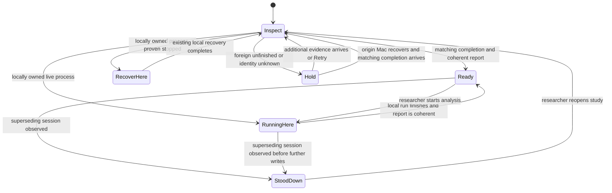
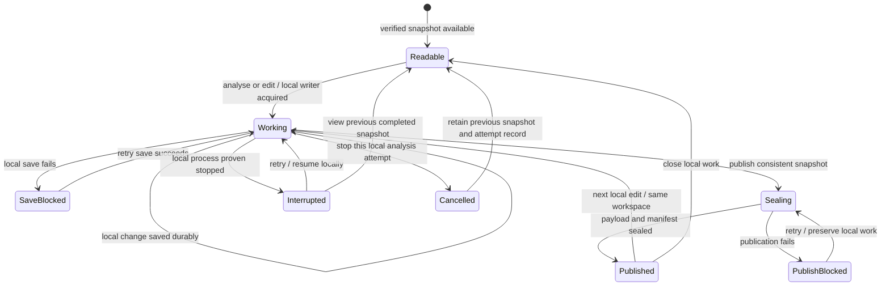
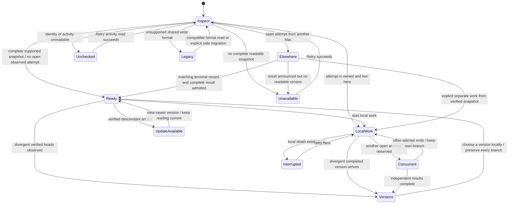

# A study on several Macs — full problem and targeted v1 guards

**Current update, 30 Oct 2026:** machine-owned automatic recovery and
conservative startup admission are integrated on local `main`. A foreign,
missing, legacy, malformed or mismatched unfinished attempt is preserved and
ordinary writers are refused before writable startup. The optional immutable
reader, editing re-entry and seamless handover remain deferred in `100days`.
The rest of this document is preserved design exploration; warning-only/Reopen
screens below are historical, not a shipping specification.

**Earlier exploration:** Owner direction, 26 Oct 2026:
assume a Studio Mac and a laptop sharing a study is ordinary App Store use;
no per-device licensing, device-count limit or documentation-only prohibition.
V1 should prevent loss and explain the limits; v2 can make handover seamless.
This supersedes the earlier recommendation to document one Mac per study.
Related ruling: #179 / R114, lifecycle failure-mode register row 32.

**Current planning priority:** begin with the smallest safety step, not the
whole v1 guard set. See the delivery table below. The broader v1 target is
sequential home/office use; it is not a requirement for the first patch. Local
working copies, immutable revisions and version-choice UI are retained here
as the initial comprehensive exploration, **not the current v1 proposal**.

## Delivery layers — minimum useful protection first

The first recovery guard and the startup refusal companion are integrated on
local `main`. The broader layers remain proposed; the separate Python producer
pilot does not activate them. These layers are not a commitment to build every
layer before shipping a useful fix. The optional reader is deliberately parked.

| Layer | Target situations | Engineering boundary | User experience | Explicitly not solved |
|---|---|---|---|---|
| **V1 first safety step** | Office opens a study while home has an unresolved run; server startup must not restore an old report over that run and delete its tree. Keep own-Mac crash recovery. | Add stable opaque machine identity to new run markers and a narrowly scoped ownership check before automatic server-start recovery. A foreign or unidentifiable attempt is not permission to restore/delete. Reuse the existing no-action outcome and logging. Test that protected files are untouched and proven local recovery still works. Do not change global liveness semantics or pretend a foreign process is live. | Backend guard alone adds no UI. The proposed visible companion uses the existing sidebar warning and popover framework below: a small typed ownership observation plus translated copy, no new surface or override controls. Normal completed opening remains unchanged. Do not show a foreign attempt as a proven local failure. | Other explicit Analyse/Re-analyse/clean paths; passive database writes; the sleeping old instance; simultaneous starts; old apps that ignore the new marker. This patch prevents the particular automatic restore/delete path, not all damage caused by opening a synced study. |
| **V1 broader guards** | One person moves home → office; delayed completion, genuine remote interruption and an old home instance waking. | Extend ownership checks to destructive run/clean paths and relevant writers; hold unresolved foreign work; distinguish local completion from uncertain remote state; investigate stale-session stand-down and draft retention. Use existing recovery/refusal infrastructure where it can express the right result. Verify copying as an independent-study escape route. No mandatory revision-store migration. | Normal travel is quiet. Exceptional cases get short explanations and automatic refusal; no takeover, force-unlock, remote Stop or version-choice controls. Existing local Retry/Stop remain. A safe Reopen can recheck; it never bypasses a hold. | Full offline concurrency; writes before a newer session is observed; automatic merge; guaranteed recovery when the originating Mac is unavailable. Stable copy identity and complete-copy consistency must be proved before recommending duplication. |
| **V2 seamless multi-Mac projects** | Broader handover, offline overlap, late results and several divergent copies/versions. | Revisit the full model below: local working copies, consistent immutable publication, version lineage, conflict preservation, compatibility and retention. Validate an architecture before selecting one; these mechanisms are candidates, not approved requirements. | Routine cross-Mac work should normally just work. Any unavoidable conflict/recovery UI needs separate product design; the three-Mac mock explores possibilities rather than setting a feature checklist. | No claim of real-time multi-user collaboration or cloud-backup guarantees merely because the study is synced. |

### First-patch stop line

Once the automatic restore/delete path is pinned shut and same-Mac recovery
still passes, **stop and review that patch**. The visible sidebar companion is separately scoped below. An extra refusal,
a new recovery action, a writer inventory or a copy workflow
is not automatically part of it. If a small additional caller guard is needed
to make the specific fix real, state that dependency; do not quietly turn the
patch into the broader v1 project. Report which existing strict expected
failures remain, rather than marking all of R114 resolved.

This is deliberately partial protection for a small number of dangerous
cases. Do not sell it as multi-Mac support, a shared lock, a safe concurrent
database or a reason to trust a completion record that has not arrived.

### Fit to the existing project-status framework — 26 Oct 2026

Mock recipe: `.claude/skills/bn-mockup/SKILL.md`, bn-accurate intent, with native `ProjectCellSpec` rather than web lens styles. The HTML remains an approximation of AppKit materials and SF Symbols; proposed copy and commentary are marked outside the product frame.

This supersedes the reduced mock's earlier centred warning page. Use the
existing sidebar subtitle, glyph and transient popover, not a new screen,
modal, titlebar pill or toast. This is proposed copy, not approved translation.

| Observed situation | Sidebar subtitle | Kind and door | Detail / options |
|---|---|---|---|
| Coherent completed study, nothing new to report | None | No glyph | Ordinary project opening; retain the existing session count. |
| Unresolved attempt identified as another Mac's | **Started on another Mac** | `warning`: `exclamationmark.triangle.fill`, system orange. Glyph and subtitle are one popover control. | Heading repeats subtitle. Body: “Analysis started on Home Mac. This Mac cannot check whether it finished. Open the study there to check it.” No takeover, remote Stop or force-unlock. |
| Origin cannot be established, including an old marker | **Activity not confirmed** | Same warning and door | “This Mac could not confirm where this analysis started. The existing work has been left in place.” Do not invent a computer name or declare a crash. |
| A newer session is observed by an old instance — broader v1 only | **Changed on another Mac** | Same warning and door | Name the Mac in the body when known; explain reopening before editing. If an unsaved draft exists, preserve it and say so; do not offer a Reopen that discards it. Writer stand-down is a separate engineering task. |
| Proven local activity, local interruption or user Stop | Existing status | Existing progress/error/no-glyph rules | Keep existing behaviour. A remote marker is not evidence for a local spinner or a red failure. |

**Geometry and interaction.** The foreign row is 22 English characters; it
must still be measured at the current 163pt subtitle budget, native caption
font and accessibility sizes, then checked in all 21 locales. Twenty-two is
not a cross-language character limit. Keep the dynamic computer name out of
the narrow row. Normal clean rows remain the compact Schema E rows. The title
still selects the project; the whole glyph/subtitle strip opens details.

Reuse the popover envelope: 360pt width including 16pt insets, content-sized
height with a 320pt ceiling, selectable body, headline status and the existing
`doc.on.doc` Copy control. Show Log only where an actual local log is available;
no decorative disabled log button. No bottom action row. Existing project verbs
remain in their natural menus; a safe Reopen rechecks and never overrides a hold.
The HTML mock uses browser stand-ins for native symbols, not new product icons.

**Classification and precedence.** Treat ownership uncertainty as a typed
project observation, not a fabricated failed pipeline event or new failure
category. Wire the selected subtitle through `glyphKind` / `glyphAction` and
extend `SubtitleGlyphContractTests`. Replace the synthetic “stopped unexpectedly”
interpretation of that same foreign attempt; do not suppress a genuine unrelated
local failure or higher-priority availability problem. Keep one winning subtitle,
not concatenated warnings. Where the observation belongs alongside existing
`SubtitleDelta` data must be settled from the implementation, not by pretending
a foreign process is locally alive.

**Scope honesty.** A backend-only reclaim guard cannot deliver this notice.
The visible companion needs ownership data reaching the native project status,
localized row/body keys (including unknown-name fallback) and focused status
contract tests. This is a modest addition using existing surfaces, not zero-word
work. Neither the notice nor the guard alone makes passive writes, explicit
Analyse/clean or old-instance wake safe. Do not imply a read-only report until
its writers are actually guarded. The mock leaves the foreign report unopened;
that is a preview boundary, not a new proposed blank-page design.

Read against [the glyph rule](design-desktop-project-status.md#the-glyph-rule--attention-not-action-settled-27-aug-2026),
[diagnostic popovers](design-pipeline-diagnostic-popover.md),
`MessageKind.swift`, `ProjectSubtitle.swift`, `ProjectCellSpec.swift`,
`ProjectDiagnosticPopover.swift` and `ProjectFilesPopover.swift`.

### Duplication as a possible ordinary escape route

The owner suggested duplicating a study in Finder, continuing with the copy,
and deleting the original later when satisfied. This fits the existing study
identity design and avoids adding takeover controls. It is a **broader-v1
verification case**, not a first-step feature or a proven workaround today.

The current app can re-mint a copy when both distinct folders are recognised
(`ProjectIndex.captureStudyID`; `StudyMarker.remint`). A Finder copy also
inherits the run marker/history, and copy detection depends on which folders
the app knows about. A copied identity must not leave the independent study
permanently held by its parent's run, nor may path differences alone be taken
as proof of a copy (a move is still the same study).

Test a coherent completed copy separately from a copy made during active
writes; WAL mode alone is not proof that an arbitrary multi-file copy is
consistent. Preserve analysis and curation where valid, never touch the
original as part of opening the copy, and do not recommend deleting the
original until the researcher has verified the independent copy. No Duplicate
or force-unlock button is proposed here.

Initial comprehensive UX scenarios: [multi-Mac study mockup](mockups/multi-mac-study.html).
The picker has 25 situations, three example Mac viewpoints (not a device cap),
working recovery/version-choice sheets, and an expandable action inventory.
It illustrates the full model, not the reduced v1 screens or guarantees.

Reduced, no-override proposal: [v1 guard mockup](mockups/multi-mac-v1-guards.html).
Its 16 cases show automatic holds and warnings, not takeover or version choices.
The original three-Mac mock is unchanged. No production behaviour is implied.

## Decision trail — 26 Oct 2026

1. The original audit recommended documenting one Mac per study, with a small
   foreign-run reclaim guard (#179 / R114). The owner rejected the usage
   assumption: a powerful home Mac and a portable Mac on one iCloud account
   is normal App Store use, not a licensing or device-activation problem.
2. Requested the N-Mac state machines and meaningful UX scenarios. The initial
   analysis below explored the full problem: uncertainty, independent offline
   starts, partially received results, divergent edits, late completion,
   consistent SQLite snapshots and backwards compatibility. It proposed local
   working copies and immutable version publication as the strong boundary.
3. After viewing the 25-case mock, the owner asked for a much smaller v1:
   one human on one account, normally one actively used Mac at a time. Typical
   journey: leave Bristlenose open at home, go to work, open the study there;
   home remains on Wi-Fi, its analysis normally finishes during the journey,
   and it may sleep afterward. Three-Mac use is less important. Preserve the
   full analysis for later; target inexpensive protection for that journey.

4. The owner then asked whether v1 could warn/refuse without offering recovery
   choices, and requested a separate mock of that reduced target while keeping
   the initial three-Mac exploration. The current G2 below is the no-override
   variant; the earlier conditional Continue idea is retained as a deferred alternative.
5. The owner suggested Finder duplication as an ordinary escape route, then
   requested an explicit separation of v2, broader v1 and first safety steps:
   minimum engineering and minimum new surfaces for a few dangerous cases,
   with the full problem retained for future work. The delivery table is the
   implementation-scope guide; the larger mock is not the first-patch brief.

Steps 1 and 3 are owner direction. The guard design and draft wording below
are engineering proposals, **not a final ruling or a promise of safety**.

## Targeted v1 — sequential use by one person

### Working assumptions and their limits

Optimise the normal path for a completed study moving between two Macs.
Opening it at the office should not require a licence switch, device limit,
version browser, branch merge or routine ownership confirmation. An app left
open at home is not evidence of concurrent human editing.

These assumptions reduce the expected frequency of concurrent work; they do
not turn elapsed travel time into proof of completion. Completion must still
be tied to the correct attempt, and files must be readable and internally
consistent. Sleep, late sync and a real crash may leave the same incomplete
evidence. A background server can also write without a human touching it.

### Scenarios retained for v1

| Target | Ordinary situation | Required outcome |
|---|---|---|
| V1-A | Home finished; office has a coherent report and matching completion | Open normally, without ceremony. No assumption that every other Mac has also received it. |
| V1-B | Home finished in reality, but office sees a start without its completion | Do not call it a local crash, restore the old report over it, delete it or silently start another run. Clear from coherent matching completion; no override here. |
| V1-C | Home actually stopped halfway through; office sees that same unresolved start | Preserve the attempt and prior report. Recover on the originating Mac; offer no takeover here. |
| V1-D | Home was left open and wakes after work continued at the office | Once home observes that its session was superseded, stop its background writes before they alter the newer work. Do not silently resume old queued operations. |
| V1-E | This Mac's own process really crashed | Keep normal local crash recovery working; distinguish machine identity from a display-name change or PID reuse. |
| V1-F | Identity, marker or report cannot be read, or comes from an older build | Unknown must not count as locally abandoned. Keep safe existing data; classify the compatibility case explicitly before allowing recovery. |

Reading a completed report while temporarily disconnected is still normal
local file use. Existing bounded file-read failures remain ordinary errors,
not a cloud-progress or “Waiting for iCloud” state; see
[the cloud-file policy](design-cloud-files.md).

### What moves out of v1

| Initial full-model concern | V1 disposition |
|---|---|
| Several people editing the same study | Not a target workflow. No multi-user permissions, collaboration or presence service. |
| Deliberate simultaneous offline editing/analysis | Not supported by these guards. Do not claim a distributed lock or preservation of every divergent result. |
| Automatic merge and multi-version selection | Defer; no revision DAG, branch browser or merge UI in the proposed v1 guard set. |
| Live progress or remote Stop on another Mac | Defer; show only observed start/completion facts, never inferred liveness. |
| Heartbeats, expiring leases and timed takeover | Omit; they do not prove that remote work ended and add mechanisms to the ordinary journey. |
| Seamless mid-analysis handoff/cache transfer | Defer. A run normally finishes where it began; reuse of partially synced paid intermediates is not promised. |
| Special three-or-more-Mac UX | Deprioritise, not a device limit. Identity comparisons must still work for any number of machine IDs. |
| Immutable shared revisions and a local workspace migration | Retain below as a future strong solution; not the default v1 implementation. Reconsider only if write-path inspection shows a small guard cannot protect the target cases. |

### Proposed lightweight guards

**G1 — machine-aware automatic recovery.** Record a stable opaque machine
identity on new run markers. Only automatically reconcile a crash positively
identified as this Mac's. A foreign or unknown marker is not permission to
restore, clean, synthesize failure, replace its marker or delete its work.
Apply this before every destructive recovery entry, not just the sidebar or
one `reclaim_after_crash` caller. Machine labels are presentation only.

**G2 — normal completed opening; no cross-Mac override.** A matching
completion and coherent readable report opens normally. For an unresolved
foreign attempt, hold analysis, editing and destructive cleanup. Draft:
**“Analysis started on Home Mac. Open this study on Home Mac to finish or
recover the analysis.”** There is no Continue, force-unlock, remote Stop or
version-selection control. A matching terminal record plus a coherent report
clears the hold automatically; a timeout never does. A known terminal failure
must be reconciled safely on the originating Mac before granting writes here,
not treated as permission to discard a foreign partial attempt.

If the originating Mac has been lost, wiped or cannot be used, v1 has **no
in-app recovery escape hatch** for this hold. That is a deliberate limitation
to approve before implementation, not something Retry fixes. Only show a
previous report during the hold if it can be opened without server/import or
background writes; the mock conservatively offers no report-opening action.
Unknown/older markers remain a separate compatibility decision.

**G3 — stale open instances stand down.** A session identity distinguishes
an old opening on home from a newer office session opening a completed study
for ordinary work. No exceptional Continue action is needed to create that
successor session.
Recheck before background writes and on wake/return to use. If home observes
that it has been superseded, stop its writers/queued mutations and ask for
the study to be reopened. This must cover import, registry, curation and
maintenance writers, not just analysis starts. If a view cannot be opened
without those writes, do not present it as a safe read-only report.

G3 is best-effort across delayed sync, not distributed fencing: a superseding
record home has not received cannot stop its next write. Inventory writers
and check the critical paths before estimating or approving implementation.
Do not describe G3 as protection against all concurrent SQLite access.

### Reduced observational state machine

This describes a proposed local decision, not globally authoritative ownership:

There is no timeout transition from Hold to Ready. Failed preservation stays
in Hold. New files or a terminal line alone do not establish a coherent report.
Exactly what happens to an already-running local process on supersession is
still a design question: do not imply an unsaved-work-discard policy here.

### Acceptance checks for this subset

1. V1-A opens without a new dialog or version picker.
2. Opening B on a foreign unresolved marker performs no destructive reclaim,
   including when its PID happens to match an unrelated local process.
3. B refuses a second run/clean before touching the foreign tree. Test every
   entry path; deciding to guard only automatic opening is a narrower partial
   fix and must be labelled as such.
4. Reboot/rename/PID reuse cannot turn another Mac into this Mac, or prevent
   ordinary own-Mac crash recovery. Older/unreadable markers have an explicit
   tested fallback; they are not silently accepted as local.
5. No Continue, force-unlock, remote Stop or version-choice controls exist.
   A foreign real crash stays held until safely resolved on its originating
   Mac. Missing completion never authorises file movement or backup replacement.
6. Home observing the office continuation stands down before its next guarded
   write. An unobserved continuation remains a documented residual risk.
7. No test or UI claims that normal travel time, a quiet folder, sleeping,
   Wi-Fi connectivity or age of a start proves that remote work has ended.

### Deferred alternative — conditional Continue (earlier v1 exploration)

Before the no-choice variant, G2 considered a Continue Here confirmation,
conditional on a consistent nondestructive copy under unique recovery names.
That raised live-tree rename, SQLite/WAL-copy consistency and retained-backup
questions. It is **not in the current v1 mock or guard set**. Keep it as a
possible future escape hatch, not as an action for an implementer to add.
The full model below retains its own stronger separate-version recovery.

### Stand-down with an unsaved draft

The reduced mock includes a deliberately unresolved edge: an old window has
unsaved text when it observes a newer session. Stop its writes and retain the
draft; do not show a Reopen button that discards it or say it was saved.
A small draft-preservation mechanism needs assessment before G3 is called
complete. No merge/version UI is proposed for this case. Conversely, if no
draft exists, Reopen is one safe reread/recheck action, not an override; it may
lead back to G2's hold if the other Mac now has an unfinished analysis.

**Next engineering step:** inspect the ownership/backup and passive-writer
seams, choose compatibility behaviour, then scope the smallest test-pinned
implementation. No product changes are authorised by this capture request.

## Initial comprehensive analysis — retained for future work

> **Scope history:** the sections below and the 25-case mock explore the full
> N-Mac problem. Their references to “v1” reflect the initial proposal before
> the sequential-use narrowing above. They are not the present v1 commitment.
> Retained to explain the complexity and the stronger guarantees a future
> architecture would need to earn. No initial proposal has been implemented.

## The architectural finding

A file synced between Macs is not a distributed lock. A and B can both be
offline, each see no owner, and both start. No machine id, waiting period,
heartbeat or local flock can rule that out. An announced start gives useful
awareness; it cannot promise single-writer enforcement across N Macs.

Therefore distinguish **preventing an avoidable second start** (when another
attempt has been observed) from **preserving both results anyway** (when the
announcement was delayed). Do not ship a new status label as a data-loss fix.

The safety design below requires a material storage change: app-local working
copies plus separate, immutable published revisions. It is larger than the
original recovery guard. This document exposes that cost for an owner ruling;
it does not silently authorise a storage migration.

## Initial full-model safety boundary

- Each Mac edits/analyses an app-local working database, outside the shared
  study folder. Only that Mac's locally fenced writer can change it. All write
  surfaces count: quote edits, names, stars, tags, AutoCode, import and analysis.
- Shared recordings remain where the researcher put them. No mandatory full
  media copy, provider management, cloud-progress UI or new device limit.
- Publish a consistent closed/checkpointed snapshot to a unique revision
  directory, with its parent revision(s), study id, revision id and integrity
  manifest. Never sync an open SQLite database or its live WAL as the report.
- A publication is first private/staged, then sealed. Other Macs admit it only
  after bounded reads verify every required file. A seal arriving first is
  insufficient. Keep the previous admitted revision when a read fails.
- Revisions have globally unique ids; concurrent writers never share output
  names. Do not publish a mutable global `latest` pointer as authority. Each
  Mac derives the heads of the revision graph it can actually verify.
- An attempt announcement identifies study, base revision, machine id and
  attempt id. A completion/cancel/failure closes only that matching attempt.
  Machine names are display labels, never identity. Missing terminal records
  mean unknown; age alone never authorises recovery or deletion.
- Independent revision branches are preserved. V1 offers inspection and a
  choice of which version to use on this Mac, not automatic merging or silent
  last-writer-wins. Selecting one never deletes or globally replaces another.
- A user-requested recovery on B creates separate work from an admitted
  snapshot. It does not seize A's run or send a remote stop. A late finish by A
  becomes another version, not a file to discard.
- No automatic garbage collection of another Mac's work/revisions in v1.
  Deleting a study or a version is a separate explicit destructive action.

This preserves work generated by Bristlenose; it cannot guarantee a cloud
backup, save work after the local disk failed, defeat deletion of the whole
study by its owner/provider, or prevent duplicate paid analysis during a
network partition. Do not market those guarantees.

## Model for N Macs

For each Mac i, maintain a private workspace W_i and the verified revision set
R_i it has observed. Each attempt has a unique id, local owner and base
revision. Sync can bring any subset of records/files in any order. A candidate
enters R_i only when fully verified. Publication never mutates an existing
revision. R_i need not equal R_j; neither Mac claims to see all work everywhere.

For one study, every Mac runs the same two machines below. A third or tenth
Mac adds more observations/branches, not more pairwise states or licences.
There is no enforceable global `owned by Mac A` state in this v1 model.

## Machine 1 — one local work attempt and its publication

`Published` means a revision was written and verified here. It never means
that all Macs received it. Run termination and report publication are distinct:
a failed run may leave a valid partial result; a completed run may fail to
publish. Show the actual local outcome, never a remote guess.

An external start observation does not erase or silently cancel this machine's
work. It changes machine 2's available actions. A local writer fence prevents
an older attempt from publishing into its replacement's local workspace.

## Machine 2 — what a particular Mac shows and permits

Precedence: unreadable/unsupported storage prevents new writes; a local save
failure takes priority over any success indicator. Local work plus observed
remote work is Concurrent, not Elsewhere. Divergent results are Versions, not
an automatically chosen winner. An incoming compatible descendant while the
reader is selecting text does not jump their view. No transition is triggered
by `last update older than N minutes`.

## UX vocabulary and mock coverage

All wording is draft English for owner review; no locale keys added. The
mockup explores the current direction, not two competing visual styles.

| Scenario | What this Mac can honestly say | Available actions / outcome |
|---|---|---|
| Ready on this Mac; others absent or unknown | ordinary report, no global ownership promise | Analyse; edit; export a completed local snapshot |
| Analysis running here | Analysing on This Mac; stage from local process | Stop Analysis; View Previous Report if one exists |
| Another Mac announced analysis; previous report exists | Analysis started on Studio Mac; started time | View Previous Report; Work on This Mac… |
| Same, first analysis; no previous report | same start fact; no report invented | Work on This Mac…; leave study open or close it |
| Studio Mac sleeps or goes offline | identical to the preceding observed-elsewhere state | no timeout takeover, no remote kill |
| Studio Mac crashed but this Mac has no proof | identical to sleeping/offline | explicit separate local work is the way forward |
| Same-Mac process demonstrably crashed | Analysis stopped unexpectedly | Retry; View Previous Report; retain failed attempt |
| Matching remote cancellation/failure arrived | Analysis on Studio Mac did not finish | Analyse on This Mac; View Previous Report if present |
| Completion arrived but version cannot be read/verified | This version couldn’t be opened | Retry; View Previous Report if present; no partial DB open |
| Complete new descendant arrived while reading | New version available | View New Version; keep reading without being moved |
| Another completed version arrived after local edits | Two versions of this study | View Versions; Keep Working Here; preserve both |
| Two starts while disconnected; announcement arrives late | Another Mac also started analysis | Stop This Analysis; Keep Analysing; no automatic cancellation |
| Recovery requested without proof A is stopped | Work on this Mac? Both versions will be kept | Cancel; Work on This Mac; duplicate LLM costs may occur |
| Original Mac finishes after that recovery | Two versions of this study | inspect versions; choose local view; neither deleted |
| Three or more divergent versions | Several versions of this study | list every verified head; choose local view; no merge claim |
| This Mac has no connection but an admitted report | ordinary locally readable report | reading/export work; explicit local branch if unresolved foreign work observed; no connection detector needed |
| Identity/activity cannot be read | Study activity couldn’t be checked | Retry; View Saved Report; no write into shared mutable data |
| Local save fails | Your latest changes couldn’t be saved | Retry Save; keep the draft and do not claim it was saved |
| Local work saved; publication fails | Changes saved on this Mac; couldn’t publish this version | Retry; continue local work; preserve existing revisions |
| Legacy/older incompatible app | This study needs a newer version of Bristlenose | Update; view compatible saved report if safe; no in-place conversion during an unresolved attempt |
| Two windows on the same Mac | same shared local operation state | one local writer; normal windows, no second-device warning |
| Machine renamed | new label, same identity and operation | no takeover, no false foreign run |

Closing a window is not stopping analysis. No action labelled Stop targets
another Mac. A separate-work confirmation should disclose duplicate analysis
cost when relevant, not threaten that the other Mac's work will be destroyed.

## Draft recovery sheet

**Work on this Mac?**

Analysis started on Studio Mac at 10:00. Bristlenose can’t check whether it is
still running there. Work here will start from the saved report on this Mac.
Both versions will be kept. Analysing again may use additional AI credits.

**Cancel** (safe default) · **Work on This Mac**

For editing-only recovery, omit the analysis-cost sentence. Do not promise
reuse of the other Mac's paid intermediates unless that cache is verified and
portable. No “Stop Waiting” or destructive force-unlock is needed under this
snapshot model.

## Implementation seams to assess before approval

Current recovery is `server.app.create_app` →
`utils.output_backup.reclaim_after_crash` → `reclaim_stale` → `settle`.
Current ownership is `_write_pid_file` / `_is_alive_owned` in
`run_lifecycle.py`; `run_condition.pid_file_liveness` and Swift
`EventLogReader.pythonRunPID` interpret it. Current DB import/curation writes
must be inventoried as a whole, not guarded only at the Analyse button.

1. Confirm an app-local working-copy and snapshot boundary covers every
   writer, background job, CLI command and MCP read. Agent reads must never
   receive a partially admitted revision; show local draft only under the
   researcher's existing explicit access policy.
2. Prove consistent SQLite snapshot/export construction; no open-WAL copy.
3. Specify local crash durability and publish cadence for ordinary edits.
   “Saved” must mean durable locally. Export must reflect that local save.
4. Establish backwards compatibility: older builds must not write into the
   new publication area; the new format cannot claim protection from an old
   build still mutating/deleting the legacy shared output. Safe migration and
   minimum-version metadata require a separate measured plan.
5. Stable opaque machine identity shared by CLI/native sidecar; record only
   derived identity, not raw hardware identifiers. No paid-device limit.
6. Storage retention and local-cache size: revisions are not a free backup
   service. No automatic cross-Mac pruning or automatic conflict merge in v1.

## Acceptance cases for the N-Mac model

- Open on B during A's re-analysis: no restore, deletion, DB write or forced
  terminus in A's attempt. Previous verified report may be read safely.
- Partition all N Macs, start from the same parent, then deliver every record
  in different orders: preserve every successfully published branch.
- Deliver seal before payload, missing file, failed bounded read, corrupted
  content, and a duplicate terminal record: do not admit an invalid revision.
- Announce complete then disconnect before publication: keep old readable
  report; do not claim crash or completeness of the new report.
- Retry on B, then let A complete late: neither branch overwrites the other.
- Local edits while new data arrives: preserve current reading/selection and
  local draft; offer the new version rather than switching silently.
- Rename the machine, reboot, change PID, use two windows, or restart the app:
  identity and local fencing remain correct.
- One old app and one new app: demonstrate the actual compatibility boundary,
  rather than counting the new marker as protection against old writers.

## Initial full-model decisions — deferred, not a current v1 checklist

Approve or reject the local-workspace/immutable-revision safety boundary;
the draft words; whether v1 may offer separate-version work before ordinary
multi-version inspection exists; publication cadence and retention. The mock
shows the coherent end-to-end behaviour, not a promise that it is a one-day
patch. No production code, locale or release change accompanies this proposal.

## Current implementation entry point — 27 Oct

See [owner read-only design](design-study-read-only.md) and
[implementation plan](design-study-read-only-plan.md) for the current sequential
v1 scope and POC-backed build sequence. This document retains its scenario or
deferred-operation role; it is not an alternative implementation specification.
