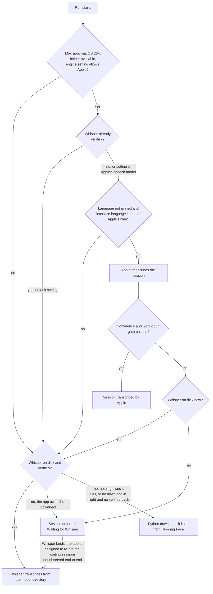
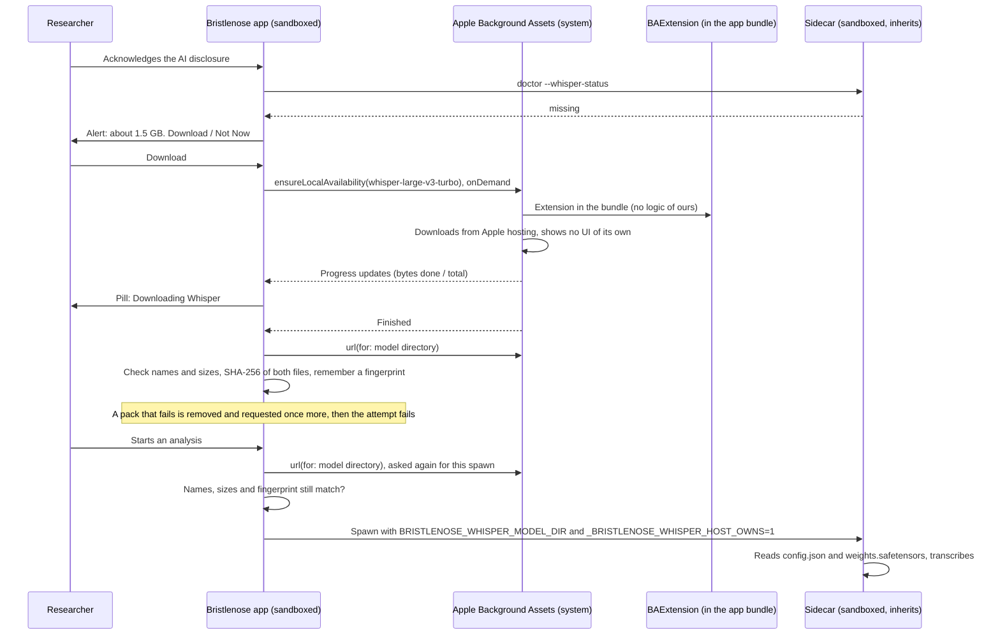

# How the Mac App Store build delivers and uses its Whisper speech model

This document says what the Mac App Store build of Bristlenose does to get a Whisper speech model onto the Mac and to transcribe with it, and why. It is written for an App Review reader and for the maintainers who come after. Every claim carries an evidence code (E1 to E8, listed in §12) or is marked **not verified**. §11 is the honest list of what has not been tested.

## 1. Purpose and decision summary

Bristlenose turns recordings of interviews into a report. Transcription quality decides the quality of everything after it: a wrong word becomes a wrong quote. The App Store build therefore transcribes with **Whisper large-v3-turbo**, a model of about 1.5 GB (a 1.5 GB download, 1.6 GB on disk), and not a smaller one.

A 1.5 GB model should not sit inside an app bundle that every user downloads whether or not they transcribe. So the model arrives separately, as data, after the user has been told its size and has agreed.

| Decision | Choice | Reason |
|---|---|---|
| Model | Whisper large-v3-turbo (`mlx-community/whisper-large-v3-turbo`). The Background Assets pack was built from revision `a4aaeec0636e6fef84abdcbe3544cb2bf7e9f6fb`; the Hugging Face route requests the repository by name and is not revision-pinned. | Transcription quality on poor audio and overlapping speech needs the large model (owner position, settled). |
| Delivery on macOS 26 and later, store build | Apple Managed Background Assets, Apple-hosted | The platform's own mechanism for large data a store app needs after install; Apple hosts, resumes across app quits, and keeps the data out of the app bundle. |
| Delivery on macOS 15, in the `.dmg`, and as fallback | Download from Hugging Face by the bundled sidecar | Background Assets needs macOS 26. The path already ships and works on every Mac the app supports. |
| First study on macOS 26 and later | Apple's on-device speech model (`SpeechTranscriber`), in the languages it covers | A first recording does not wait for the 1.5 GB model. Whisper takes over once it is on the Mac. |
| Deployment floor | macOS 15.0 | Support as many Macs as possible. The extension targets 26.0 and is not loaded on 15. |
| Consent | Size shown and Download / Not Now asked before the app starts the download by itself | Guideline 4.2.3(ii). See §7. |
| Copy on the Background Assets path | Never promises or denies that a download resumes | The app trusts the operating system's contract and does not describe behaviour it does not control. |

Status. The owner's strategy (17 Nov 2026) is to submit on 24 Nov 2026 with Background Assets as the preferred delivery, Apple's speech model as the instant first study where macOS 26 provides it, and the app's own Hugging Face download wherever the OS is too old or Background Assets fails. The aim for every macOS version is the same four properties: the highest transcription quality (Whisper large-v3-turbo), an immediate start, a fast initial download, and the platform's native mechanism wherever one exists. The Background Assets code is on two unmerged branches (`ba-whisper-build`, `ba-whisper-embed`); main carries the Hugging Face path, the size prompt (`2fcbaaccc`) and Apple's engine. If App Review rejects the Background Assets design, the owner decides then what to ship; this document does not pre-decide it. §11 lists what is still open, and the open items in it are the work to close before submission.

## 2. The three engines and which runs when

| Engine | Where it runs | Needs a download | Covers | When it is used |
|---|---|---|---|---|
| **Apple speech model** (`SpeechTranscriber`) | On the Mac, in a signed helper bundled with the app | Apple's per-language model, fetched by macOS on first use (E7). Not Bristlenose's download and not covered by our size prompt. | Nine languages: English, Spanish, French, German, Italian, Portuguese, Korean, Japanese, Chinese (the app maps the interface language to a locale; how each Chinese variant maps was not re-checked here) | macOS 26 or later, the Mac app only, while Whisper is not on disk, when the interface language maps to one of the nine. Not in the CLI. |
| **Whisper large-v3-turbo, delivered by Background Assets** | On the Mac, in the sandboxed sidecar (MLX) | The 1.5 GB pack from Apple's hosting | Every language Whisper detects | Store build (App Store or TestFlight), macOS 26 or later, once the pack is verified on disk. |
| **Whisper large-v3-turbo, delivered by Hugging Face** | Same | The same weights from `huggingface.co`, by `doctor --fetch` in the sidecar | Same | macOS 15; the Developer ID `.dmg` on every macOS; the CLI; and the store build when Background Assets is switched off, unavailable, or has just failed. |

The pack holds `config.json` (268 bytes) and `weights.safetensors` (1,613,977,612 bytes); the app pins a SHA-256 for each and checks them before use. **The Hugging Face route is not hash-checked by the app:** it fetches the repository snapshot by name (about 1.61 GB, the whole snapshot, not only these two files). On the build date the weights matched the pack in size and in a sampled checksum (sum of the first byte of every 4 KB page); a full SHA-256 of the Hugging Face copy was not computed (E1). A transcript from the sandboxed sidecar reading the pack matched the Hugging Face run on one 45 second English clip, text, case and punctuation compared with whitespace collapsed, timecodes compared as displayed to the second; the sidecar was ad hoc re-signed with the real entitlements, macOS 27.0 (E2).

### Which runs, per recording

Apple's engine is chosen once per run, in `choose_engine` (`bristlenose/apple_speech.py`). It is chosen only when all of these hold:

1. the Mac app, which bundles the helper (not the CLI);
2. the helper answers and reports Apple's model available (macOS 26 or later);
3. Whisper is not on disk, under the default engine setting. The setting *Apple's speech model* skips this test;
4. the transcription language is not pinned;
5. the interface language is the researcher's own (picked in Settings, or among the Mac's preferred languages) and maps to one of Apple's nine.

Apple needs a language before it starts, and Whisper detects it. So Apple's engine **assumes the recording is in the interface language** (owner decision, 18 Oct 2026). A wrong guess is caught by a per-session gate: mean word confidence under 0.5, or too few words per minute of speech, sends the session to Whisper. Measured on five recordings, a wrong language gave a few words at about 0.10 to 0.30 confidence (the code comment says 0.38) against 0.92 to 0.93 in the right language. Five files are too few to settle the threshold (existing design record: `docs/design-apple-first-transcription.md`).

A session Apple defers waits ("Waiting for Whisper") and runs on Whisper when Whisper lands. A session Apple kept stays Apple's.

## 3. OS versions by channel

"Store build" means the build distributed through the Mac App Store or TestFlight. The `.dmg` is the Developer ID build distributed from bristlenose.app. The `.dmg` contains no extension and no Background Assets keys; a release gate fails if it does (E3).

| macOS | Channel | Whisper delivery | First study | What the user sees |
|---|---|---|---|---|
| 26 or later | Mac App Store, TestFlight | Background Assets; falls back to Hugging Face for that launch if it fails (§6) | Apple's model, in the nine languages | After the AI disclosure is acknowledged and with 10 GB free: an alert with the size ("about 1.5 GB"), Download or Not Now. A "Downloading Whisper" pill with progress. A Whisper row in Settings with Download Now. |
| 15 | Mac App Store | Hugging Face. The extension is not loaded; the Background Assets code is behind an availability check for macOS 26. | None. Recordings wait for Whisper. Transcripts can be imported with no download. | The same alert, pill and Settings row. A recording is transcribed once the download finishes. |
| 26 or later | `.dmg` | Hugging Face | Apple's model | The same alert and pill. |
| 15 | `.dmg` | Hugging Face | None | The same alert and pill. |
| any | CLI (`pip`, Homebrew, Snap, Copr) | Hugging Face cache, by the user's command (`bristlenose doctor --fetch`) or on first run | None (no helper) | Terminal progress. No alert: the person typed the command. |

Not verified: macOS 15 with the real store build (a toy on a macOS 15 guest took the no-Background-Assets path, E1); macOS 26.x with anything (E1 could not run there).

## 4. How the pack is downloaded and handed to the sandboxed sidecar

The sidecar is a bundled Python program (PyInstaller) that runs the pipeline. It is sandboxed with `com.apple.security.inherit`, so it has the app's sandbox and no more.

Facts the diagram depends on, each measured on a development-signed toy on macOS 27.0 against a local `ba-serve`, unless stated (E1):

- The pack does not land in the app group. `url(for:)` returns a path under `~/Library/Daemon Containers/<id>/Data/Library/Caches/<bundle>/Staging/Unlocalized/`, owned by the system. A `removeItem` from the sandboxed app failed with error 513; the app removes a bad pack only through the system's own `remove` call. Writing to it was not tested.
- **The grant is per `url(for:)` request.** A child process read `weights.safetensors` but got ENOENT on `config.json` until the app had asked for the model *directory*. So the app asks every time before it spawns the sidecar. A unit test pins that the app asks its adapter for the directory on every spawn; the sandbox grant itself was measured on the toy and the store build, not by that test.
- A profile carrying the team identifier is mandatory for the system to accept the extension. A profile-less build is rejected.
- `url(for:)` never throws for a file that is absent. The app therefore never trusts it alone and checks names, sizes and the stored fingerprint.
- The extension is a one-line `StoreDownloaderExtension` with no logic of ours, (the toy extension measured 5.3 MB footprint and 18 MB resident while a download ran; the shipping extension was not measured).

On the real store build (E5), TestFlight 0.46.0 build 6532 on macOS 27, on 17 Nov 2026:

- The pack arrived through Background Assets: started about 12:20:04, and at 12:22:29 the system helper reported to TestFlight "version 1 of asset pack whisper-large-v3-turbo for app.bristlenose was successfully downloaded", about 2.5 minutes. No Hugging Face process was seen and no Hugging Face folder appeared. The Mac was not clean: Whisper had been cached from Hugging Face earlier and was parked first, and the download was started with Download Now in Settings, not from the alert.
- A three-session project was then re-run with Whisper. The log records session 1 (1,092 seconds) transcribed and merged and session 2 with 236 segments; the third session is not in the log I read. The log shows `preflight_whisper: mlx-community/whisper-large-v3-turbo delivered by the host app`, `backend=mlx model=large-v3-turbo`, the sidecar spawned with the model directory in the Daemon Containers area, and sessions transcribed.
- The sidecar is given the model directory only for a pack the app has verified. That the run received the directory is evidence the SHA-256 check passed; the verification log line itself was not captured. The transcript was not compared with a Hugging Face run on this build.

## 5. What is in the pack, and why it is data and not code

| Property | Fact | Evidence |
|---|---|---|
| Contents | Exactly two files in one directory: `config.json` (268 B) and `weights.safetensors` (1,613,977,612 B). The packer refuses to add anything else. | E4, `build-whisper-pack.sh` |
| Format | `safetensors` holds tensors and nothing else. It cannot carry code. `config.json` is JSON. | Format specification |
| Allowlist | The verifier rejects any other file in the directory, including a second copy of the weights or a script. | `WhisperPackVerifier.quickCheck`, unit-tested |
| Integrity | The app pins a SHA-256 for each file, built from the real pack. A pack whose hash differs is not used. The Hugging Face route has no such check in the app. | E4, E6 |
| How it is used | The sidecar passes the directory to `mlx_whisper` as a model path. The bytes are read as arrays. They are never imported, loaded as a library, or run. | `s05_transcribe.py` |
| What Apple allows | Apple's Background Assets documentation lists machine-learning models as asset pack content and bars macOS executables from packs. | E7 |
| The code that is delivered | The extension and the sidecar are inside the signed app bundle that App Review receives. Nothing the app executes arrives after review. | E3 |

The sidecar carries the `disable-library-validation` entitlement (for its bundled Python libraries). The pack is hash-checked even though Apple hosts it. On the Hugging Face route the app relies on the host and on TLS alone (open item 8).

## 6. Failures and recovery

Rules the code follows (owner, 16 Nov 2026): after a failed attempt the app tries again at the next opportunity (a run starting, a launch, Download Now). No recovery depends on how the system behaves after a failure. Nothing the app shows promises or denies resume.

"Tested" below says how far each row has been exercised. **Real-app network failure on a signed build has not been tested; it is designed and unit-tested only.**

| Situation | What the app does | Tested how |
|---|---|---|
| **Network off before the download** | `AssetPackManager` throws (toy: "Could not connect to the server", `SwiftErrorProjection` code 1). The attempt ends as failed; this launch hands to the Hugging Face fetch, which also fails offline and reports a cause the researcher can act on (the connection dropped, disk full, or a certificate not trusted). The pill stays with Retry. Next launch or Download Now asks Apple again. | Error shape measured on the toy (E1). Acquirer and fallback unit-tested (E6). Not run end to end offline. |
| **Network lost during the download** | Toy: the system fails the download with -1005 and does not retry by itself. A new request, observed 10 s and 30 s later, restarted from byte 0 (no Range header sent, though the server supported it). The app treats it as a failed attempt: fallback for this launch, Apple again next time. | Measured on the toy with a throttling TLS proxy (E1). Not on a real network or a signed build. |
| **App quit mid-download** | The system keeps downloading without the app (system behaviour; the app promises nothing about it). Toy: it finished 2 minutes 13 seconds after the kill, and a relaunch re-attached and found it complete. | Measured on the toy (E1). Not on the real app. |
| **Sleep and wake, reboot, battery throttling** | Left to the system. The app has no logic for these. | **Not measured.** |
| **Low disk** | The app does not start a download by itself with under 10 GB free. Download Now in Settings is not held by this. If space runs out during a Hugging Face fetch the pill names disk as the cause. | Rule unit-tested. Background Assets with a full disk not tested. |
| **Partial or corrupt pack** | After arrival the app checks names, sizes and SHA-256 off the main thread. A mismatch removes the pack and requests it once more. A second mismatch ends the attempt as failed (fallback). A pack that was not verified by the app (delivered by the system on its own, or left by a failed check) is never handed to the sidecar. | Unit-tested; the acquirer's mutation pass (13 mutants: 9 caught first time, 1 equivalent, 3 gaps fixed) covered the retry and fallback (E6). Not run against a really corrupted download. |
| **The system cancels the request** | The acquirer reports a cancellation nobody here asked for as a stop, and the model remembers it as the researcher's Stop, so no automatic retry happens until Download Now (`WhisperDownloadModel`, `if case .stopped = outcome, !stopAsked`). This conflicts with the rule above and is an open item. | Read in code; not exercised. |
| **Researcher presses Stop, then Download Now** | Stop cancels the request (the system reports -999) and is remembered, so the app does not restart the download on its own. Download Now clears the remembered Stop and asks Apple again. | Unit-tested. Cancellation behaviour measured on the toy (E1). |
| **Background Assets fails, or goes silent for 60 seconds** | The attempt ends. For this launch the Hugging Face fetch takes over. The next launch, or Download Now, asks Apple again. If the attempt never reported a byte, the app asks the system to drop the unfinished pack and waits (up to 5 seconds) so a late arrival cannot be mixed with the fallback. A complete pack is never deleted. | Unit-tested (E6), reviewed twice for the double-download case (E8). |
| **Pack removed by the system** | Before every run the app asks for the directory afresh and checks names and sizes. If the pack is not there, the sidecar is not told the app owns the model, and the run downloads it as it always has. | Reasoned and unit-tested. The toy could not simulate a system purge. |
| **Kill switch** | The preference `BristlenoseBackgroundAssets` (default on) set to off means `AssetPackManager.shared` is never touched and every download goes through Hugging Face. Written for a tester who hits trouble. Developers report that a misconfigured `AssetPackManager` can crash rather than throw (E7, second-hand); we did not see it on macOS 27.0. | Code and unit tests. The `defaults write` command for a sandboxed build (written to the container's plist by path) is **untested on a signed build**. |
| **A second fetcher while Apple downloads** | `_BRISTLENOSE_WHISPER_HOST_OWNS=1` makes Python refuse to fetch. With the model absent the session is deferred ("Waiting for Whisper") and the run completes. | Measured on the toy and the rebuilt sidecar: refuses, writes 0 KB; the control run fetches (E1, E2). |

## 7. Size disclosure and consent

The app does not start its own background Whisper download without the alert. It does so only when all of these hold (`WhisperDownloadModel.autoStart`):

- the build has Whisper;
- the researcher has acknowledged the AI disclosure that names the providers their transcripts go to (the app does nothing on its own before that);
- no analysis is running and the model is missing or partial;
- the researcher has not pressed Stop or Not Now earlier;
- at least 10 GB is free (unknown free space counts as room).

Then the app shows a standard alert once per install:

> **Download the Whisper speech model?** About 1.5 GB. It helps with poor audio and people talking over each other. You can download it later in Settings. [Download] [Not Now]

*(English wording as in the build; strings `desktop.modelDownload.askTitle`, `askBody`, `askSize`, `askDownload`, `askNotNow`, in 21 locales.)*

Not Now is remembered as a Stop, and the app leaves the model alone until the researcher uses Download Now in Settings. The same alert and rules apply on both delivery routes, because they sit above the choice of route. The app never asks Background Assets to start a download on its own (policy `onDemand`; it does not call `checkForUpdates()` cold, which would start one).

**Exception, an open item:** a run that needs Whisper when no download is in flight and no verified pack is present (after Not Now, with under 10 GB free, on macOS 15, with a pinned language or an interface language outside the nine) reaches the sidecar's own preflight, which fetches from Hugging Face without the alert. The alert guards the app's background download, not that path.

Open items on this section (see §11): the English wording is not yet owner-approved and 20 locales carry it until they are translated; and Apple's own per-language speech model, which macOS downloads for the first study, is not covered by this alert.

## 8. Privacy: what leaves the Mac

This section is exact about model delivery. It does not describe the analysis stage, where transcript text goes to the AI provider the researcher chose. That is a separate, existing disclosure, acknowledged before anything is sent (`docs/glossary.md`, `docs/methodology/consent-gradient.md`).

| Step | Who receives a request | What is sent | Study data included |
|---|---|---|---|
| Whisper via Background Assets | Apple (App Store / TestFlight delivery and Apple's hosting) | Apple's own download traffic for an installed app's asset pack, handled by macOS. Bristlenose sends no request of its own. | None. No audio, transcript or project name. |
| Whisper via Hugging Face (fallback, macOS 15, `.dmg`, CLI) | `huggingface.co` and its content hosts | A normal HTTPS request for the model files: the Mac's IP address and the request headers of `huggingface_hub`. | None. |
| Apple's first study | Apple, on first use of a language, if macOS does not yet hold Apple's model for it | A system download of Apple's model. Bristlenose passes no recording to Apple's servers; transcription runs on the Mac. | None. |
| Transcription itself (either engine) | Nobody | Audio is read from the project folder and transcribed on the Mac. | Not applicable. |

Bristlenose does not describe itself as local-first or privacy-first, because the analysis is a call to a cloud model. What this section claims is narrower: **the model download carries no study data to anyone, and audio is transcribed on the Mac by both engines.** That the Hugging Face request carries nothing else beyond the headers above is from reading the code; the wire has not been captured for the store build (a proxy run is owed, §11).

## 9. Guidelines

Guideline text quoted as read on 16 Nov 2026; Apple's page carries no revision date.

| Guideline | What it asks | How the design answers | Verified | Not verified |
|---|---|---|---|---|
| **2.4.5(iv)** (Mac App Store) | No downloading or installing "additional code, or resources to add functionality or significantly change the app from what we see during the review process" | The app a reviewer sees already transcribes with Whisper. The pack is that feature's model, as data, with the same weights as the Hugging Face copy, hash-pinned. On macOS 26 and later Apple's model transcribes before the pack arrives (macOS may fetch Apple's own model first). | Contents, format, hash pin; identical bytes; the Apple engine runs without the pack (E2, E4, E5). | Whether a reviewer reads the pack as "adding functionality": it adds every language outside Apple's nine, and on macOS 15 nothing transcribes without it. Reviewers have reported failing to fetch Apple-hosted packs in review (E7); the outcome for this app is unknown. |
| **2.5.2** | Self-contained bundles; no reading or writing outside the container; no downloading, installing or executing code that changes features | The pack is data in the location the system manages, read through Apple's `url(for:)` API, read-only to the app. Nothing from it is executed. The extension and the sidecar are in the bundle. | Read access and read-only behaviour on the toy; the extension is signed in the store bundle and passes the package gate (E1, E3, E5). | That App Review accepts a sandboxed child process reading the system-owned area. The kernel sandbox-denial log was not re-read for the last runs. |
| **4.2.3(ii)** | If the app must download resources to function on first launch, disclose the size and prompt first | The app does not need the download to function on macOS 26 and later (Apple's engine). On macOS 15 a recording needs Whisper, so the size alert and Not Now apply before the app starts anything itself. | The alert and its strings exist on main (`2fcbaaccc`); the rules in §7 are unit-tested. | The sequence disclosure, then alert, then download has not been observed on a clean Mac in the store build. A relaunch on build 6532 showed no alert and the cause is unknown (§11). |
| **5.1.2(i)** | Say what user data is shared with third parties, and get permission | Model delivery shares no user data (§8). The disclosure that names Claude, ChatGPT, Gemini and Azure OpenAI as recipients of transcript text appears first and must be acknowledged before the Whisper download. | By code reading: the Whisper auto-start is gated on that acknowledgement. | Behaviour on a clean install in the store build; a captured network trace. |

## 10. What App Review will and will not see

Apple's documentation says sandbox accounts cannot download Apple-hosted packs, and developers have reported that App Review could not fetch them (E7, read 16 Nov 2026; second-hand). So a reviewer may never get the pack. The design works without it:

- On macOS 26 or later, the first study runs on Apple's model with no pack.
- If the reviewer chooses Download and Apple's hosting does not answer, Background Assets fails or reports no byte for 60 seconds, and the Hugging Face fetch takes over for that launch if the reviewer's network allows it. If it does not, the pill shows the failure and Retry.
- If the reviewer chooses Not Now, the app starts no background download. A later run that needs Whisper still fetches it (§7 exception).
- On macOS 15, Apple's engine does not exist, so a reviewer can use imported transcripts or wait for the Hugging Face download.

What a reviewer sees in each of these cases has been designed and unit-tested, not observed under review conditions.

## 11. What is verified and what is not

| Claim | Status | Evidence |
|---|---|---|
| App Store Connect accepts the ExtensionKit extension, the Background Assets keys and a 26.0-targeted extension inside a floor-15 app | **Verified.** Build 6531 processed VALID. (6530 failed ITMS-90360, a missing display name; fixed.) | E4 |
| App Store Connect accepts and processes the 1.5 GB pack | **Verified.** `READY_FOR_TESTING`, 17 Nov 2026 11:37 GMT, 1,501,833,754 bytes, `0 errors, 0 warnings`. | E4 |
| The pack arrives through Background Assets in the real app | **Verified** on one Mac: macOS 27, TestFlight build 6532, about 2.5 minutes. | E5 |
| The sandboxed sidecar transcribes from the delivered pack in the real app | **Verified** for the sessions in the log (session 1 merged, session 2 transcribed) on build 6532. | E5 |
| The waiting sessions re-run by themselves when Whisper lands | **Not observed**; the owner re-ran by hand on 6532. | E5 |
| Pack text equals the Hugging Face transcript | Verified on a dev-signed sandbox run, one 45 s English clip. **Not compared on the store build.** | E2, E5 |
| The `.dmg` carries no extension and no Background Assets keys | **Verified** on an evidence build: publish gate "Shippable". | E3 |
| The store package passes all gates with the extension | **Verified** on an evidence build (the one red row, build number, was Xcode's export renumbering). | E3 |
| macOS 26.x (any behaviour) | **Not verified.** The development-signed toy is killed on an unprovisioned guest; only TestFlight on a 26.x Mac can show it. | E1 |
| macOS 15 with the real store app | **Not verified.** Only a toy took the no-Background-Assets path. | E1 |
| App Review's handling of the Apple-hosted pack | **Not verified.** First submission is unreviewed. | none |
| Real-network failure and recovery on a signed build | **Not verified.** Designed and unit-tested; toy measurements on loopback or a local proxy only. | E1, E6 |
| Sleep, wake, reboot, battery behaviour | **Not measured.** | none |
| A really corrupted download is caught by SHA-256 | **Not verified.** Verification is unit-tested with broken fixtures. | E6 |
| System purge of the pack | **Not simulated.** | E1 |
| Kill switch on a signed build | **Not verified.** | none |
| Apple's engine on the nine languages in the store build | Not re-verified for this document; earlier trial and 22 Oct unparking. | existing design record |
| Network traffic of the store build matches the register | **Not verified.** Register built by reading code; no proxy run. | none |
| The Apple-engine transcript carries word timings in every language | **Not measured**; Apple documents time ranges but not run granularity. | none |
| The adapter compiles with the Xcode 26.3 that CI uses | **Not verified.** Compiled against SDK 27.2 only. | E8 |

Known gaps in the experience, recorded as open items and not fixed:

1. **Selecting Whisper in Settings > Transcription runs Apple's engine until the model is on disk, with no explanation.** The setting says Whisper; the run says Apple. A run's log gives the reason ("first run"), the interface does not. Candidate fixes need owner decisions on wording and on whether selecting Whisper should offer the download.
2. **The Settings byte text read "Zero KB"** while the bar moved, on build 6532. Cause not investigated.
3. **No size alert appeared at a relaunch** on build 6532. The cause is unknown: a remembered answer, the consent gate, or timing.
4. **"Language not supported" has no message.** A session Apple cannot take is deferred and the row shows "Waiting for Whisper" until Whisper lands; with Whisper absent and Background Assets failing, it waits indefinitely. Needs owner approval for new interface text.
5. **Apple's per-language model download is not announced by us** and has no size alert. The system performs it.
6. **The size alert wording** is the placeholder; 20 locales hold English until translated and approved.
7. **The system-cancel case and the preflight fetch** in §6 and §7 contradict the stated rules and are not fixed.
8. **The Hugging Face route has no app-side hash check.** Pinning a revision and a hash there would close it.
9. **Merging the branches** stales every sidecar until `build-sidecar.sh` runs, and needs the test inventory regenerated (independent review, E8).

## 12. Evidence

All times London unless stated. The working notes are private to the maintainer; the facts used here are restated above so this document stands alone.

| Code | What | Date | Conditions |
|---|---|---|---|
| E1 | Spike measurements: extension registers, pack downloads, per-request access rule, error shapes, interruptions, read-only pack, mlx wheels, macOS 15 toy | 16 to 17 Nov 2026 | macOS 27.0, Xcode 27.2, development-signed toy, local `ba-serve` and a throwaway CA. Nothing against Apple's hosting or a real network. |
| E2 | Rebuilt sidecar, ad hoc re-signed with the real entitlements, run from the pack in the sandbox, compared with the Hugging Face run | 17 Nov 2026, 00:03 to 00:08 | One 45 s English clip. |
| E3 | Signed store archive, package gate, `.dmg` gate | 17 Nov 2026 | Evidence builds from a clean clone; dependencies differ from the main venv; not a ship candidate. |
| E4 | App Store Connect: extension build 6531 VALID; pack uploaded (`READY_FOR_TESTING`); manifest hashes match the pinned values | 17 Nov 2026, 10:12 and 11:37 GMT | Owner-authorised uploads. |
| E5 | TestFlight 0.46.0 build 6532 on this Mac: pack arrival and first Whisper run | 17 Nov 2026, 12:20 to 12:55 | macOS 27, one Mac, internal TestFlight. |
| E6 | Unit tests: acquirer, picker, verifier, fallback, kill switch; mutation pass (13 mutants); Python resolver and guard | to 17 Nov 2026 | Counts were logged at different tips (Swift 87 of 87 flag off and on at 01:34; Python 686 selected at 23:05). No run is logged after the later fix commits and the tip. |
| E7 | Apple documentation and forum reports on Background Assets, asset pack contents and App Review | read 16 Nov 2026 | Forum text is as relayed by a fetch tool, not byte-verified. |
| E8 | Independent adversarial review of both branches | 17 Nov 2026, about 01:20 | Seven serious and several minor findings; the build session fixed them. |

Code: `desktop/Bristlenose/Bristlenose/` (`WhisperModelAcquirer.swift`, `BackgroundAssetsAcquirer.swift`, `AssetPackManagerAdapter.swift`, `WhisperPackVerifier.swift`, `WhisperDownloadModel.swift`), `desktop/BAExtension/`, `desktop/scripts/build-whisper-pack.sh`, `bristlenose/preflight/whisper.py`, `bristlenose/apple_speech.py`, `bristlenose/stages/s05_transcribe.py`.
