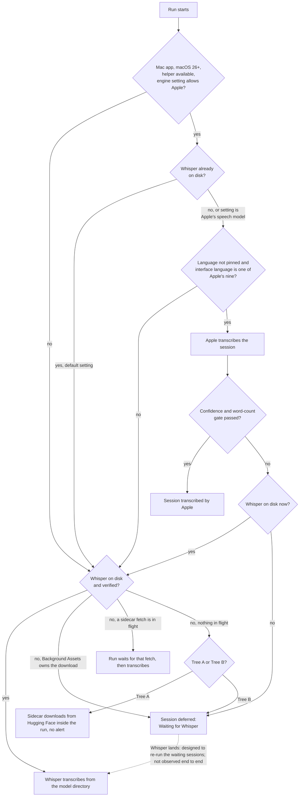
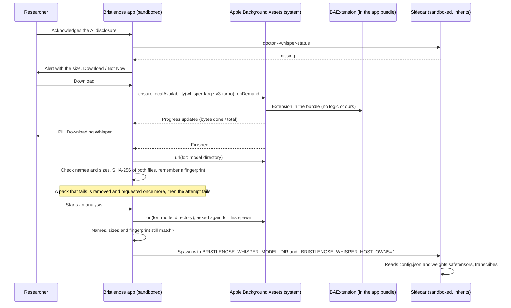

# How the Mac App Store build delivers and uses its Whisper speech model

This document says what the Mac App Store build of Bristlenose does to get a Whisper speech model onto the Mac and to transcribe with it, and why. It is for App Review readers and for later maintainers. Each claim carries an evidence code (E1 to E9, §13) or is marked **not verified** or **by code reading**. §12 lists what has been tested and what has not. §11 lists the decisions that are open.

## Which tree this describes

Two source trees matter, and they behave differently. Every sentence below that depends on the difference names the tree.

| Name | What it is | Where it exists | Built or observed |
|---|---|---|---|
| **Tree A** | Branch `ba-whisper-embed` at the commit that produced TestFlight build 6532 (`e9f3617ff`, built in a clone with `BN_BA_WHISPER=1`). The branch tip `1c3e5f027` has the same key files. | Local branch, not merged | TestFlight 0.46.0 build 6532, internal only, macOS 27, one Mac (E5). An evidence build, not a ship candidate: its dependencies differ from the main venv. |
| **Tree B (the candidate, the shipping tree, decided D1 on 17 Nov 2026)** | Tree A plus commit `bb60d1b0c` (system cancel is not a Stop; Hugging Face fetch pinned and hash-checked; a run honours Not Now; the "Zero KB" text fixed), plus the release-script row that sets `BN_BA_WHISPER=1` and a binary gate (D2). | Branch `ba-whisper-candidate`, tip `8f4fd1f25`; `bb60d1b0c` itself is on `claude/ba-gap-closure-488c85`. Not merged: the owner expects to merge the candidate into main before submitting, moment not chosen. | **In no build yet.** Unit-tested only (Swift flag off and on, Python for the touched areas). The first signed, TestFlight-verified candidate build is still to be produced by the build session. |

Main carries neither: it has the Hugging Face path, the size alert (`2fcbaaccc`) and Apple's engine, with the Background Assets adapter compiled out.

**A default store archive does not use Background Assets.** `desktop/scripts/build-all.sh` defines the `BA_WHISPER` compile condition only when `BN_BA_WHISPER=1` is set (the script's own comment: "the committed default stays dark"), while the extension and the Background Assets keys are embedded regardless. An archive made without that variable carries the extension and keys with the adapter compiled out, so every user gets the Hugging Face route (build 6531 was built this way). The owner decided on 17 Nov 2026 that Tree B ships (D1) and that `release.sh` sets the variable for the store lane with a gate that fails if the extension is embedded and the adapter is not compiled in (D2). Both are in the candidate and in no build yet. Plan A for 24 Nov includes Background Assets; if Apple rejects it, the plan is to unwind to the Hugging Face path. Nothing below should be read as describing a default archive.

Until a candidate build exists and has been verified on TestFlight, every statement about Tree B is by unit test or code reading, and the signed-build evidence (E5) is Tree A's.

## 1. Purpose and decision summary

Bristlenose turns recordings of interviews into a report. Transcription quality decides the quality of everything after it: a wrong word becomes a wrong quote. The App Store build therefore uses **Whisper large-v3-turbo** (about 1.6 GB on disk), not a smaller model. A model that size should not be in the bundle every user downloads, so it arrives separately, as data.

| Decision | Choice | Reason |
|---|---|---|
| Model | Whisper large-v3-turbo (`mlx-community/whisper-large-v3-turbo`). The Background Assets pack was built from revision `a4aaeec0636e6fef84abdcbe3544cb2bf7e9f6fb`. On Tree A the Hugging Face route requests the repository by name and is not revision-pinned. On Tree B a fresh fetch is pinned to that revision and hash-checked (§5). | Quality on poor audio and overlapping speech (owner position, settled). |
| Delivery on macOS 26 and later, store build | Apple Managed Background Assets, Apple-hosted, requested on demand | The platform mechanism for large data a store app needs after install. Apple hosts it and keeps it out of the bundle. |
| Delivery on macOS 15, in the `.dmg`, in the CLI, and as fallback | Download from Hugging Face by the bundled sidecar | Background Assets needs macOS 26. |
| First study on macOS 26 and later | Apple's on-device speech model (`SpeechTranscriber`), in the languages it covers | A first recording need not wait for the model. Whisper is used once it is on the Mac. |
| Deployment floor | macOS 15.0 | The extension targets 26.0. |
| Consent | The app shows the size and asks (Download / Not Now) before it starts its own background download | Guideline 4.2.3(ii). See §7. |
| Wording on the Background Assets path | Never promises or denies that a download resumes | The app does not describe behaviour of the system that it does not control. |

Owner strategy (17 Nov 2026): the 24 Nov submission uses Background Assets where macOS 26 or later provides it, Apple's speech model for the first study, and the app's own Hugging Face download where the OS is too old or Background Assets fails. If App Review rejects the Background Assets design, the owner decides then what to ship; this document does not pre-decide it.

## 2. The three engines and which runs when

| Engine | Where it runs | Download | Covers | Used when |
|---|---|---|---|---|
| **Apple speech model** (`SpeechTranscriber`) | On the Mac, in a signed helper bundled with the app | Apple's model for the language, which **our helper requests** (`AssetInventory.assetInstallationRequest(...).downloadAndInstall()`) if macOS does not hold it. No size is shown by us and no prompt precedes it. By code reading. | English, Spanish, French, German, Italian, Portuguese, Korean, Japanese, Chinese (how each Chinese variant maps was not checked) | macOS 26 or later; Mac app only; Whisper not on disk (default setting); language not pinned; interface language is the researcher's own and maps to one of the nine; kill switches on. Not in the CLI. |
| **Whisper large-v3-turbo via Background Assets** | In the sandboxed sidecar (MLX) | The pack from Apple's hosting | Every language Whisper detects | Store build, macOS 26 or later (observed on 27.0 only), `BA_WHISPER` compiled in, kill switch on, a verified pack on disk. |
| **Whisper large-v3-turbo via Hugging Face** | Same | The model repository from `huggingface.co`, fetched by the sidecar | Same | macOS 15; the Developer ID `.dmg` on every macOS; the CLI; the store build when Background Assets is off, unavailable or has failed. |

Both Whisper routes load `config.json` (268 bytes) and `weights.safetensors` (1,613,977,612 bytes). The app pins a SHA-256 for each and checks the pack against them. The Hugging Face route on Tree A fetches the whole snapshot (about 1.61 GB) and is not checked by the app. On the build date the Hugging Face weights matched the pack in size and in a sampled checksum (the first byte of every 4 KB page); a full SHA-256 of the Hugging Face copy was not computed (E1). A transcript from the sandboxed sidecar reading the pack matched the Hugging Face run on one 45 second English clip (text, case and punctuation compared with whitespace collapsed; timecodes compared as displayed to the second). The sidecar was ad hoc re-signed with the real entitlements, macOS 27.0 (E2).

### Which engine runs, per run

Apple's engine is chosen once per run in `choose_engine` (`bristlenose/apple_speech.py`), and only when all of these hold:

1. the Mac app, with its bundled helper and sidecar (not the CLI);
2. the helper answers and reports Apple's model available (macOS 26 or later);
3. the Apple-speech kill switch is on;
4. Whisper is not on disk, under the default engine setting (the setting *Apple's speech model* skips this test);
5. the transcription language is not pinned;
6. the interface language is the researcher's own (chosen in Settings or among the Mac's preferred languages) and maps to one of the nine.

Apple needs the language before it starts, and Whisper detects it. So Apple's engine **assumes the recording is in the interface language** (owner decision, 18 Oct 2026). A per-session gate catches a wrong guess: mean word confidence under 0.5, or too few words per minute of speech, sends the session to Whisper. On five recordings a wrong language gave a few words at about 0.10 to 0.30 confidence against 0.92 to 0.93 in the right language (the code comment says 0.38); five files are too few to settle the threshold. The gate judges a whole file by its mean, so a recording in two languages can pass with one lost. A session Apple keeps stays Apple's, so a project can hold transcripts from both engines. The engine is recorded per session but shown only in the Diagnostics view. (Existing design record: `docs/design-apple-first-transcription.md`.)

A session Apple defers waits ("Waiting for Whisper"). Tree A and Tree B differ on how it then gets Whisper (§6, §7).

## 3. OS versions by channel

"Store build" means the Mac App Store or TestFlight build. The `.dmg` is the Developer ID build from bristlenose.app. The `.dmg` contains no extension and no Background Assets keys; a release gate fails if it does (E3). The "user sees" column is derived from code and **has not been observed on any build** unless stated.

| macOS | Channel | Whisper delivery | First study | What the user sees (by code) |
|---|---|---|---|---|
| 26 or later (observed on 27.0 only) | Store build, archive made with `BN_BA_WHISPER=1` | Background Assets; Hugging Face for that launch if it fails (§6) | Apple's model, nine languages | After the AI disclosure is acknowledged, with at least 10 GB free: an alert with the size, Download or Not Now. A "Downloading Whisper" pill. A Whisper row in Settings with Download Now. |
| 26 or later | Store build, default archive | Hugging Face (adapter compiled out) | Apple's model | The same alert, pill and row. |
| 15 | Store build | Hugging Face. The extension is meant not to load on 15 (a toy on 15.7.3 took the unavailable path, E1; the store build has never been installed on 15). | None | The same alert, pill and row. Nothing transcribes until the download is done. Transcripts can be imported with no download. |
| 26 or later | `.dmg` | Hugging Face | Apple's model | The same alert and pill. |
| 15 | `.dmg` | Hugging Face | None | The same alert and pill. |
| any | CLI | Hugging Face cache, by `bristlenose doctor --fetch` or on first run | None (no helper) | Terminal progress; no alert. |

macOS 15 evidence (E9) is from the `.dmg` build, not the store build, and says nothing about Background Assets there. On a 15.7.7 guest the `.dmg` app launched; Settings > Transcription showed a Whisper row "Not on this Mac" with a button and no Background Assets control. The button (a deliberate click) started the sidecar fetch at once; 1.1 GB had arrived by about 40 seconds and 1,543 MB at the end, in the app's container, and the row then read "On this Mac · 1.61 GB". **Not observed on 15:** a size alert, the pill, or a transcription in any language (a run stopped at the AI provider key check). The first-launch flow was not reached.

## 4. How the pack is downloaded and handed to the sandboxed sidecar

The sidecar is a bundled Python program (PyInstaller). It is sandboxed with `com.apple.security.inherit`, so it has the app's sandbox and no more.

Facts the diagram depends on. Measured on a development-signed toy on macOS 27.0 against a local `ba-serve` unless stated (E1):

- The pack does not land in the app group. `url(for:)` returns a path under `~/Library/Daemon Containers/<id>/Data/Library/Caches/<bundle>/Staging/Unlocalized/`, owned by the system. A `removeItem` from the sandboxed app failed with error 513. The app removes a bad pack only through the system's `remove` call. Writing to it was not tested.
- **The grant is per `url(for:)` request**, on the toy only: a child process read `weights.safetensors` but got ENOENT on `config.json` until the app had asked for the model *directory*. The app therefore asks before every spawn. A unit test pins that `runEnvironment` asks the adapter for the directory; it does not pin the spawn site, and the grant itself was observed on the toy.
- A provisioning profile carrying the team identifier is required for the system to accept the extension.
- `url(for:)` does not throw for an absent file, so the app checks names, sizes and its stored fingerprint.
- The extension is a `StoreDownloaderExtension` with no logic of ours. A footprint was measured only for the toy extension (5.3 MB, 18 MB resident).

On the store build 6532 (Tree A, E5), macOS 27, 17 Nov 2026, internal TestFlight:

- The pack arrived through Background Assets: from about 12:20:04 to 12:22:29, when the system helper reported to TestFlight "version 1 of asset pack whisper-large-v3-turbo for app.bristlenose was successfully downloaded" (about 2.5 minutes). No Hugging Face process or folder appeared. The Mac was **not clean**: Whisper had been cached from Hugging Face before and was parked, and the download was started with Download Now in Settings, not from the alert. The size alert was not seen on that build (§12).
- A project was then re-run by hand with Whisper. The log shows `preflight_whisper: ... delivered by the host app`, `backend=mlx model=large-v3-turbo`, the sidecar spawned with the model directory in the Daemon Containers area, session 1 (1,092 seconds) transcribed and merged, and session 2 with 236 segments.
- That the sidecar received the model directory means the app's SHA-256 check passed. The log line for the check was not captured. The transcript was not compared with a Hugging Face run on this build.
- TestFlight serves the latest processed pack without review. None of this shows what App Review or the public App Store will do.

## 5. What is in the pack, and why it is data and not code

| Property | Fact | Evidence |
|---|---|---|
| Contents | Two files in one directory: `config.json` (268 B) and `weights.safetensors` (1,613,977,612 B). The packer refuses anything else. | E4, `build-whisper-pack.sh` |
| Format | `safetensors` is a tensor container with no mechanism to execute anything. `config.json` is JSON. | Format specification |
| Allowlist | The verifier rejects any other file in the directory (a second copy of the weights, a script). | `WhisperPackVerifier.quickCheck`, unit-tested |
| Integrity of the pack | A SHA-256 per file is pinned in the app, built from the real pack. A pack that does not match is not used. | E4, E6 |
| Integrity of the Hugging Face route | **Tree A:** none in the app. The repository is fetched by name, and `mlx_whisper` can load `weights.npz` if it is present in the snapshot. **Tree B:** a fresh sidecar fetch is pinned to the revision, allowed only `config.json` and `weights.safetensors`, and checked against the same pinned hashes. By unit test, not yet in a build. Not covered on Tree B: `mlx_whisper`'s own load-time `snapshot_download` on a run that was handed a repository name instead of a directory (D12). | E6, code reading |
| How it is used | The sidecar passes the directory to `mlx_whisper` as a model path. The bytes are read as arrays. They are not imported, loaded as a library or run. | `s05_transcribe.py` |
| What Apple documents | Apple's Background Assets documentation describes asset packs as holding assets such as machine-learning models. The statement that macOS executables are barred was not found on the pages reached. | E7 (second-hand, not byte-verified) |
| Code that arrives after review | None. The extension and sidecar are in the signed bundle App Review receives. | E3 |

The sidecar carries `disable-library-validation`, `allow-jit` and `allow-unsigned-executable-memory` entitlements for its bundled Python libraries and MLX. A reviewer may ask why a process with those entitlements reads downloaded bytes; the answer is the pack checks above.

## 6. Failures and recovery

Rules the code follows (owner, 16 Nov 2026): after a failed attempt the app tries again at the next opportunity (a run starting, a launch, Download Now). No recovery depends on how the system behaves after a failure. Nothing shown promises or denies resume.

"Tested" says how far each row has been exercised. **Failure and recovery on a signed build on a real network has not been tested. It is designed, unit-tested and measured on a toy.** Rows that differ by tree say so.

| Situation | What the app does | Tested how |
|---|---|---|
| **Network off before the download** | The pack manager throws (toy: "Could not connect to the server", `SwiftErrorProjection` code 1). The attempt ends as failed. For this launch the Hugging Face fetch takes over, which also fails offline, retrying up to five times with waits of up to 300 seconds each (by code reading), then reports a cause the researcher can act on. The pill stays with Retry. | Error shape measured on the toy (E1). Acquirer unit-tested (E6). Not run offline end to end. |
| **Network lost during the download** | Toy: -1005, no retry by the system; a request 10 s and 30 s later restarted from byte 0. The app treats it as failed: Hugging Face for this launch. | Toy with a throttling proxy (E1). Not a real network or a signed build. |
| **App quit mid-download** | The system continued the download without the app on the toy (2 min 13 s after the kill) and a relaunch found it complete. System behaviour; the app promises nothing about it. | Toy only. |
| **Sleep and wake** | The app has a 60 second silence watchdog on a continuous clock. By code reading, a sleep over 60 seconds during a download can trip it and start a Hugging Face fetch from the start. Not run. | **Not tested.** |
| **Reboot, battery throttling, system pause** | The adapter ignores a "paused" status. By code reading, a pause by macOS can look like silence. | **Not tested.** |
| **Low disk** | The app does not start its own download with under 10 GB free, and says nothing. Download Now is not held by the rule. A Hugging Face fetch with a full disk reports disk as the cause (sidecar battery on 15.7.7, not through the app). | Rule unit-tested. Background Assets with a full disk not tested. |
| **Partial or corrupt pack** | After arrival the app checks names, sizes and SHA-256 off the main thread. A mismatch removes the pack and requests it once more; a second mismatch ends the attempt as failed. The sidecar is handed only a pack the app has verified. | Unit-tested; the acquirer's mutation pass (13 mutants: 9 caught first time, 1 equivalent, 3 gaps fixed) did not cover the remove-and-retry path (E6). Not run against a really corrupted download. |
| **The system cancels the request** | **Tree A:** remembered as the researcher's Stop, so no automatic retry until Download Now (conflicts with the rule above). **Tree B:** treated as a failure; the next opportunity retries. | Tree A read in code, pinned by a test that records the old behaviour. Tree B unit-tested, in no build. |
| **Researcher presses Stop, then Download Now** | Stop cancels and is remembered; the app does not restart on its own. Download Now clears it and asks Apple again. | Stop unit-tested; Download Now clearing Stop has no test of its own. |
| **Background Assets fails or reports no byte for 60 seconds** | The attempt ends and the Hugging Face fetch takes over for this launch. If the attempt never reported a byte, the app asks the system to drop the unfinished pack and waits up to 5 seconds. A complete pack is not deleted. "Reported a byte" means a progress callback arrived, so 0 of N counts. | Unit-tested with short timeouts (the 60 s and 5 s defaults are not pinned) (E6, E8). |
| **Hugging Face fallback succeeds** | The model is then on disk, so Background Assets is not asked again; the install stays on the Hugging Face copy. A later pack arrival is not used if a verified copy exists elsewhere; both can sit on disk (up to about 3.2 GB), and the pack is preferred when both exist. By code reading. | Not tested. |
| **Verified by the app but unusable by the sidecar** | The sidecar is told the app owns the model. If Python cannot read a valid MLX pack there, it refuses to fetch and defers every session. Settings reads "missing", the pill is hidden, and the only exit is the kill switch. This is the ENOENT mode seen on the toy. By code reading; macOS 26.x unverified. | Not tested. |
| **Pack removed by the system** | Before each run the app asks for the directory afresh and checks names and sizes. If it is missing, the sidecar is not told the app owns the model. **Tree A:** the run then fetches from Hugging Face inside the run. **Tree B:** the run waits (§7). | Unit-tested. Purge not simulated. |
| **Kill switch** | The preference `BristlenoseBackgroundAssets`, default on; off means `AssetPackManager.shared` is never touched and downloads use Hugging Face. It is read as a boolean, so the string `NO` reads as on. Developers report a misconfigured `AssetPackManager` can crash instead of throwing (E7, second-hand; not seen on 27.0). A reviewer cannot use it. | Unit tests. A write by path to the container's plist worked once in a Terminal (flag not named in the log); on a signed store build not tested. |
| **A second fetcher while Apple downloads** | `_BRISTLENOSE_WHISPER_HOST_OWNS=1` makes Python refuse to fetch; the session is deferred and the run completes. | Measured on the toy and a rebuilt sidecar: refuses and writes 0 KB; the control fetches (E1, E2). |
| **New weights under the same pack id** | Not designed (D10). The hashes are compiled in; Apple's hosting can update an installed pack in the background; every installed app would then reject it and fetch again. | By code reading. |

## 7. Size disclosure and consent

**Launch-time rule** (`WhisperDownloadModel.autoStart`): the app starts a background Whisper download by itself only when the build has Whisper; the researcher has acknowledged the AI disclosure (which names the providers their transcript text goes to); no analysis is running; the model is missing or partial; the researcher has not answered Not Now or pressed Stop; and at least 10 GB is free (unknown free space counts as room). It then shows a standard alert and starts only on Download:

> **Download the Whisper speech model?** About 1.6 GB. It helps with poor audio and people talking over each other. You can download it later in Settings. [Download] [Not Now]

(English wording as in the build; strings `desktop.modelDownload.askTitle`, `askBody`, `askSize`, `askDownload`, `askNotNow`, in 21 locales.) The figure is a fixed string, "1.6 GB" (owner, 17 Nov 2026; it was "1.5 GB"), an approximation true for both routes: the Hugging Face route downloads about 1.61 GB and the pill shows 1.61 GB. Re-check it at future releases. The alert is asked until it is answered, not once per install; the answer and any Stop are kept in the app's preferences and survive deleting the app. A Mac that carries a remembered Stop or an earlier answer will not show the alert, which may explain the missing alert at a relaunch of build 6532 (hypothesis, not checked). Not Now is stored as a Stop. The same alert and rules apply to both routes. The app does not ask Background Assets to download on its own: the pack's policy is `onDemand` and the app never calls `checkForUpdates()`.

**Other paths that start a download.** `startIfNeeded` can also start one after a run went to Apple's engine (with no disk floor and no run-live guard) and after a failure; the Background Assets to Hugging Face fallback starts without asking again. A prior Download answer is required in each.

**A run that needs Whisper when no download is in flight and no verified pack exists** (after Not Now, with under 10 GB free, on macOS 15, with a pinned language, with an interface language outside the nine, or after a system purge):

- **Tree A:** the sidecar's preflight fetches the model from Hugging Face inside the run. There is no size alert and Not Now does not stop it. This does not meet the stated rule.
- **Tree B:** the run defers its sessions and the app does not fetch. By unit test, in no build. By code reading, a session that needs Whisper then waits with no pill and no download if the researcher has not answered the alert (under 10 GB free, or a run live at launch) or answered Not Now, and the message says the app downloads in the background when nothing is. Decision D5.

Open items on this section: the alert wording is not owner-approved and 20 locales hold English (D8); Apple's own model download has no alert (D9).

## 8. Privacy: what leaves the Mac

This section is about model delivery. It does not cover the analysis stage, where transcript text goes to the AI provider the researcher chose; that is a separate disclosure acknowledged before anything is sent. Statements marked "by code" were not captured on the wire; a proxy run of the store build is owed.

| Step | Who receives a request | What is sent | Study data |
|---|---|---|---|
| Whisper via Background Assets | Apple | Apple's own traffic for the app's asset pack, handled by macOS. The app makes no request of its own. Apple's hosting may update an installed pack in the background. | None |
| Whisper via Hugging Face | `huggingface.co` and its content hosts | A model metadata call, revision lookup and per-file requests; the Mac's IP address and `huggingface_hub`'s User-Agent (`hf_hub/1.33.0; python/3.12`); `HF_HUB_DISABLE_TELEMETRY` is not set (by code). On Tree A the transcription library also issues a Hugging Face request each time it loads the model by name. | None |
| Apple's first study | Apple | The **app's helper** requests Apple's model for the language if macOS lacks it; macOS performs the download. No recording is sent. | None |
| Transcription itself | On the Mac, except the model requests above | Audio is read from the project folder and transcribed on the Mac by both engines. | Not sent |

Bristlenose does not describe itself as local-first or privacy-first, because the analysis is a cloud call. The claim here is narrow: **the model requests carry no recording, transcript or project name, and audio is transcribed on the Mac.** The Hugging Face request does expose the Mac's IP address to a third party, which the privacy policy needs to name.

## 9. Guidelines

Guideline text as read on 16 Nov 2026; Apple's page carries no revision date.

| Guideline | What it asks | How the design answers | Verified | Not verified |
|---|---|---|---|---|
| **2.4.5(iv)** (Mac App Store) | No downloading or installing "additional code, or resources to add functionality or significantly change the app from what we see during the review process" | The reviewed app already transcribes with Whisper. The pack is that feature's model, as data, pinned by hash. On macOS 26 and later Apple's model transcribes before the pack arrives (macOS may first fetch Apple's model). | Pack contents, format and hash pin (E4); the pack arrives and is used on one Mac (E5). | Whether a reviewer reads the pack as adding functionality: it adds every language outside Apple's nine, and on macOS 15 nothing transcribes without it. That the Hugging Face copy equals the pack in every byte (size and a sample only). Reviewers have reported failing to fetch Apple-hosted packs (E7, second-hand). |
| **2.5.2** | Self-contained bundles; no reading or writing outside the container; no downloading, installing or executing code that changes features | Data, in the system-managed location, read through Apple's `url(for:)` API. Nothing from it is executed. The extension and sidecar are in the bundle. | Delete refused on the toy; the extension is signed in the store bundle and passes the package gate (E1, E3). | That App Review accepts a sandboxed child process reading the system area; the grant on macOS 26.x; write access (not tested). |
| **4.2.3(ii)** | If the app must download resources to function on first launch, disclose the size and prompt first | The launch-time alert (§7). On macOS 26 and later the app can transcribe before the download. On macOS 15 nothing transcribes without it. | The alert and strings exist on main (`2fcbaaccc`). | The alert has not been seen on any signed build. Tree A fetches without the alert on the paths in §7. The size in the alert is 1.5 GB against 1.61 GB on one route. |
| **5.1.2(i)** | Say what user data is shared with third parties (including third-party AI) and get permission | Model delivery sends no recording, transcript or project name (§8). The AI disclosure naming the providers is acknowledged before the Whisper auto-start (by code reading). | By code reading only. | Behaviour on a clean install in the store build; a captured network trace. |
| **2.1(a)** | Completeness; no crashes or obvious technical problems | The failure paths in §6. | Unit tests; toy measurements. | Any failure path on a signed build on a real network; macOS 26.x; a crash from `AssetPackManager` on an unobserved setup. |
| **2.3.1(a)** | Describe features accurately; hidden features are not allowed | The notes describe the delivery, the fallback and the engines. The kill switch is a preference, not a hidden feature. | Not applicable. | Whether App Review reads the preference as a hidden switch. |

## 10. What App Review will and will not see

What App Review's account does when the app asks for an Apple-hosted pack has not been observed. Apple's TestFlight documentation says sandbox accounts are unsupported for testers, and developers report that App Review could not fetch Apple-hosted packs, with pre-launch downloads disabled in review (E7, read 16 Nov 2026, second-hand). Whether the on-demand request throws, hangs or succeeds for a review account is unmeasured.

By design, in each case:

- On macOS 26 or later, if the researcher chooses Download and Background Assets does not begin within 60 seconds or fails, the app downloads from huggingface.co for that launch if the network allows it. Otherwise the pill shows the failure and Retry.
- On macOS 26 or later, before the model is on the Mac, Apple's model transcribes the first recordings in its nine languages. A recording in another language, a pinned language, or one that fails the gate waits for Whisper.
- If the researcher chooses Not Now: Tree A fetches inside a later run that needs Whisper; Tree B waits (§7).
- On macOS 15 there is no Apple model. A recording needs Whisper, and imported transcripts need nothing.
- A review account needs a provider key to reach any transcript or report; without one the run stops before transcription (E9). The sample recording, transcript file and key do not exist yet (D11).
- The AI disclosure's other large download, "~2 GB" for a local model, appears in the same window as the Whisper alert on some paths; reconcile before submission (D8).
- A notification permission prompt appears during a run.

All of this is by design or code reading, not observed under review conditions.

## 11. Owner decisions

D1 and D2 were decided by the owner on 17 Nov 2026 and are recorded first. D3 to D15 are open, each with the recommendation first.

1. **D1. Which tree ships. DECIDED 17 Nov 2026: Tree B, the candidate** (branch `ba-whisper-candidate`, tip `8f4fd1f25`: the embed work, `bb60d1b0c`, and the D2 row and gate). Reason: Tree A alone fetches without the alert and records a system cancel as a Stop. Plan A for 24 Nov includes Background Assets; the owner expects to merge the candidate into main before submitting; if Apple rejects, unwind to the Hugging Face path. Still owed: a candidate build, signed and verified on TestFlight, since no build contains it.
2. **D2. The `BN_BA_WHISPER=1` default. DECIDED 17 Nov 2026: yes.** `release.sh` sets it for the store lane, and the gate that fails when the extension is embedded and the adapter is not compiled in stays. Both are in the candidate, in no build yet; the gate has not been run on a signed release archive.
3. **D3. The pack on the 24 Nov submission.** Attach pack version 1 to the first app version (status Ready for Review, not only Ready for Internal Testing); confirm the Xcode that built the pack (27.2 on 17 Nov) is a release and not a beta, and rebuild the pack if it is a beta. A pack not in the first submission is not delivered.
4. **D4. A signed missing-pack test.** One internal TestFlight build requesting a pack id that does not exist, on a macOS 26.x Mac and on 27, to see the lookup-failure path with real signing. If it crashes or hangs, submit with Background Assets dark and add it in an update. Recommended before 24 Nov; it needs an upload.
5. **D5. A recording that needs Whisper without a consent answer (Tree B).** Re-offer the size alert when a run is deferred for lack of an answer, and say on the row that the model is waiting for a download. Alternatives: leave the dead end; or on macOS 15 treat the first recording as the consent moment. New wording, so the R114 UX gate applies.
6. **D6. Settings engine control tells the truth.** Record the engine per session now (it cannot be backfilled); add a caption to the Settings row; the per-session line later. Alternatives: rename the options; accept as is.
7. **D7. "Waiting for Whisper" hint by cause**, plus a route out on the row when nothing is downloading. Alternative: leave the single hint.
8. **D8. Size alert.** The figure "About 1.6 GB" is DECIDED (owner, 17 Nov 2026: a fixed approximate string, not formatted from bytes) and the 20 locales are translated (machine translation, no native review). Still open: the macOS 15 body stating that recording needs the model; reconcile with the "~2 GB" local-model line.
9. **D9. Apple's own model download.** CLOSED by the owner, 17 Nov 2026: it is OS behaviour and not ours to fix (a researcher who installs macOS in a language likely has that model); not for v1, not an App Review concern. Do not reopen without a measured wait.
10. **D10. Pack-id immutability.** New weights get a new pack id; bytes under an id never change.
11. **D11. Reviewer assets.** An English sample recording that falls inside Apple's nine and passes the gate, a transcript file for macOS 15, and a provider key with its path in the sign-in field. Without them no reviewer reaches a report.
12. **D12. The load-time fetch in the transcription library.** Pass the library a directory on every route so it never requests the repository by name during a run.
13. **D13. The store floor.** Keep macOS 15, and run the store build on a macOS 15 guest through TestFlight first. Alternative: raise the store floor to 26.
14. **D14. System pause and sleep.** Do not run the 60 second watchdog while the system reports a pause, and test a sleep during a download. Recommended.
15. **D15. Sessions Apple kept.** Do not redo them with Whisper for 24 Nov; record the engine per session (D6).

### Owner decisions from the 17 Nov 2026 taste walk-through

Source: an adversarial Mac-taste review of this UX and a gap-by-gap walk-through with the owner (notes `review-taste.md` and `plan-17nov-agreed-fixes.md` in the orchestrating session's notes folder; research report `Background Assets download latency.md`). **These are settled. Do not reopen them without new evidence.** Implementation is in the working tree, uncommitted; the Swift was parsed but not built or run.

**Decided and built:**
- Size alert "About 1.6 GB"; the alert's four strings translated in the 20 locales that carried English copies.
- Popover: the time left on its own line with no dash (Foundation's spaced dash becomes a line break); the "Starts again from the beginning next time" note removed (the owner's ruling; the `stopNote` key is deleted); the button reads "Stop" (the Settings Stop button shares the key).
- Settings Whisper row, "Not on this Mac": a small grey line "Defaulting to Apple speech model" where Apple's engine is the other option (macOS 26+ engine row; no language check; an unsupported language fails with the normal transcription failure in the popover, accepted for v1); and a small grey line "Less than 10 GB free" (the floor's own number) when free space is below the auto-start floor, in both the engine row and the macOS 15 row. The pill says nothing.
- Project status popover: "Set Up Transcription…" opens Settings ▸ Transcription when the failure category is `.whisper`, and only in a build that has Whisper.

**Decided, not built here:**
- Blank until the first byte, and a system cancel retried at the next launch, run or Download Now: both are in `bb60d1b0c`.
- The 10 GB floor stays: the app must not be a download that succeeds and then fills the Mac.
- The Hugging Face fallback on macOS 26 and later, and the 60 second silence watchdog, stay as built for submission; the step-back is D1's unwind. Research found no time-to-first-update figure from Apple and only individual developer reports, so no new number is recommended; it is measured on the candidate build.
- 100days: the "Waiting for Whisper" wording (it assumes the researcher still knows the name Whisper); one grammar for the toolbar pills (the sidebar ring and the provider pill each have their own hover ✕; the download pills have none).

**Routes explored and dismissed:**
- A hover ✕ on the Whisper pill: left out for 24 Nov; the pill gets no new function.
- A low-disk message in the pill: the pill shows only while downloading or failed.
- A Transcription door on `.network` failures: `.network` also covers a dropped connection to the AI provider.
- A `FailureRemedy` case and button on the failed-run cover pane: the owner named the popover; the cover pane is not built.
- Gap 9 (Apple's per-language model downloads without an announcement): closed, see D9.
- macOS version differences: none (Background Assets and `SpeechTranscriber` both arrive with macOS 26); the raw `[Errno 25]` message and the other macOS 15 and `.dmg` items are parked.

**Open:**
- D7: how the "Waiting for Whisper" row reaches Settings (the owner liked a Settings door; that row has no popover), and whether a deferred run resumes by itself when the download finishes (nothing does today; a re-run picks the sessions up).
- Whether Download Now should be disabled under low disk: undecided, the status quo (enabled; the floor never held it) is kept.
- The door covers every `.whisper` failure, including native-library ones where Show Log is the better door; it takes Show Log's place in the header. Owner to confirm.
- A diagnostic whose failures are all `.whisper` per session gets no door.
- Owed on the candidate build: wifi off for a minute during a download; time from `ensureLocalAvailability` to the first status update; the `.paused` status; what a system cancel looks like; the Settings row's height when the caption appears; the progress line's separator in non-English languages; a native-speaker read of the translated alert.
- Merging `bb60d1b0c`: it wraps the note in `stopNoteApplies` and uses the deleted `stopNote` key, so drop `stopNoteApplies` and its two tests; its `WhisperAskStringsTests` pins "1.5 GB"; the pill hunk and the test insertion conflict textually, and its `progressLine` guard is a separate hunk.

## 12. What is verified and what is not

All Background Assets evidence is from internal TestFlight on one Mac (macOS 27.0), a non-clean Mac, an evidence build from a clone, with the download started from Settings. The public App Store delivery path cannot be observed before approval.

| Claim | Status | Evidence |
|---|---|---|
| App Store Connect accepts the ExtensionKit extension, the Background Assets keys and a 26.0-targeted extension inside a floor-15 app | **Verified.** Build 6531 processed VALID (6530 failed ITMS-90360, a missing display name; fixed). | E4 |
| App Store Connect processes the 1.5 GB pack | **Verified for internal TestFlight.** `READY_FOR_TESTING` (the console reads "Ready for Internal Testing"), 17 Nov 2026, 1,501,833,754 bytes, no errors or warnings. The pack is **not attached to an app version** and **has not been reviewed**. | E4 |
| The pack arrives through Background Assets in the real app | **Verified** on one Mac: macOS 27, build 6532 (Tree A), about 2.5 minutes. | E5 |
| The sandboxed sidecar transcribes from the delivered pack | **Verified** on build 6532 for the sessions in the log (session 1 merged; session 2 transcribed). | E5 |
| Transcript from the pack equals the Hugging Face transcript | One 45 s English clip, dev-signed sandbox run (E2). **Not compared on the store build.** | E2 |
| The `.dmg` has no extension and no Background Assets keys | **Verified** on an evidence build. | E3 |
| The store package passes its gates with the extension | **Verified** on an evidence build (the one red row was Xcode's export build number). | E3 |
| Tree B (the candidate) fixes, release row and gate | **Unit-tested only; in no build.** No candidate build has been signed or run on TestFlight. | E6 |
| Default store archive uses Background Assets | **No.** Only with `BN_BA_WHISPER=1`. The candidate's `release.sh` sets it (D2); not yet seen in a release archive. | `build-all.sh` |
| macOS 26.x, any behaviour | **Not verified.** The development-signed toy is killed on an unprovisioned guest. | E1 |
| macOS 15 store build | **Not verified.** Never installed there. | E1, E9 |
| macOS 15 `.dmg`: download by button | Observed (E9). Size alert, pill, transcription: **not observed**. | E9 |
| macOS 15 Hugging Face failure rows (kill -9, SIGINT, 25 s drop, offline start, low disk, disk full) | Measured with the main checkout's sidecar (0.46.0, built 16 Nov), unsandboxed, over ssh, **not through the app and not sandboxed**. | E9 |
| App Review's handling of the Apple-hosted pack | **Not verified.** | none |
| Failure and recovery on a signed build on a real network | **Not verified.** | E1, E6 |
| Sleep, wake, reboot, system pause, full disk with Background Assets | **Not measured.** | none |
| A really corrupted download is caught | **Not verified**; fixtures only. | E6 |
| System purge | **Not simulated.** | E1 |
| Kill switch on a signed build | **Not verified.** | none |
| Size alert on any signed build | **Not observed.** | none |
| Waiting sessions re-run when Whisper lands | **Not observed**; re-run by hand on build 6532. | E5 |
| Apple's engine on the nine languages in the store build | Not re-verified here. | `docs/design-apple-first-transcription.md` |
| Network traffic matches the register | **Not verified.** | none |
| Word timings in each language | **Not measured.** | none |
| The adapter compiles with the Xcode 26.3 CI uses | **Not verified.** | E8 |

Experience gaps, recorded as they stand on Tree A:

1. Selecting Whisper in Settings runs Apple's engine until the model is on disk with no explanation (D6).
2. The Settings byte text read "Zero KB" while the bar moved. Fixed on Tree B (unit-tested, in no build).
3. No size alert appeared at one relaunch of build 6532; cause unproven (see §7).
4. A session Apple cannot take shows "Waiting for Whisper" with a hint that assumes Apple heard it (D7). On macOS 15 the hint is also wrong, since Apple's engine does not exist there.
5. Apple's per-language model download has no size alert (D9).
6. The alert wording is the placeholder; 20 locales hold English (D8).
7. A missing certificate bundle shows a raw `[Errno 25] Inappropriate ioctl` message (E9).
8. Merging the branches makes every other session's sidecar stale until `build-sidecar.sh` runs, and needs the test inventory regenerated (E8).

## 13. Evidence

Times London unless stated. The working notes are private to the maintainer; the facts used here are restated above.

| Code | What | Date | Conditions |
|---|---|---|---|
| E1 | Spike measurements: extension registers, pack downloads, per-request grant, error shapes, interruptions, delete refused, MLX wheels, macOS 15 toy | 16 to 17 Nov 2026 | macOS 27.0, Xcode 27.2, development-signed toy, local `ba-serve`, throwaway CA. Not Apple's hosting, not a real network. |
| E2 | Rebuilt sidecar, ad hoc re-signed with the real entitlements, run from the pack in the sandbox, compared with the Hugging Face run | 17 Nov 2026, 00:03 to 00:08 | One 45 s English clip. |
| E3 | Signed store archive and package gate; `.dmg` gate | 17 Nov 2026 | Evidence builds from a clone; not ship candidates. |
| E4 | App Store Connect: extension build 6531 VALID; pack uploaded; manifest hashes match the pinned values | 17 Nov 2026 (build logged 10:11, pack 11:37 GMT) | Owner-authorised uploads. |
| E5 | TestFlight 0.46.0 build 6532 (Tree A): pack arrival and first Whisper run | 17 Nov 2026, 12:20 to 12:55 | macOS 27.0, one Mac, internal TestFlight, not a clean Mac. |
| E6 | Unit tests and a mutation pass of the acquirer; Python resolver and guard; Tree B tests | to 17 Nov 2026 | Counts were logged at different tips (Swift 87 of 87 at 01:34; Python 686 selected at 23:05); none logged after the later commits on Tree A. |
| E7 | Apple documentation and forum reports: Background Assets, asset packs, App Review | read 16 Nov 2026 | Forum text as relayed by a fetch tool; not byte-verified. |
| E8 | Independent adversarial review of both branches | 17 Nov 2026, about 01:12 | Seven serious findings; four fixed, three open (merge staleness, Xcode 26.3 compile, test inventory). |
| E9 | macOS 15.7.7 guest: sidecar battery on the Hugging Face path; `.dmg` app driven over ssh | 17 Nov 2026 | `.dmg` evidence build (build 6528), not the store build; battery used the main checkout's sidecar; no screenshots; Swedish test not done. |

Code: `desktop/Bristlenose/Bristlenose/` (`WhisperModelAcquirer.swift`, `BackgroundAssetsAcquirer.swift`, `AssetPackManagerAdapter.swift`, `WhisperPackVerifier.swift`, `WhisperDownloadModel.swift`), `desktop/BAExtension/`, `desktop/scripts/build-whisper-pack.sh`, `desktop/scripts/build-all.sh`, `bristlenose/preflight/whisper.py`, `bristlenose/apple_speech.py`, `bristlenose/stages/s05_transcribe.py`.
